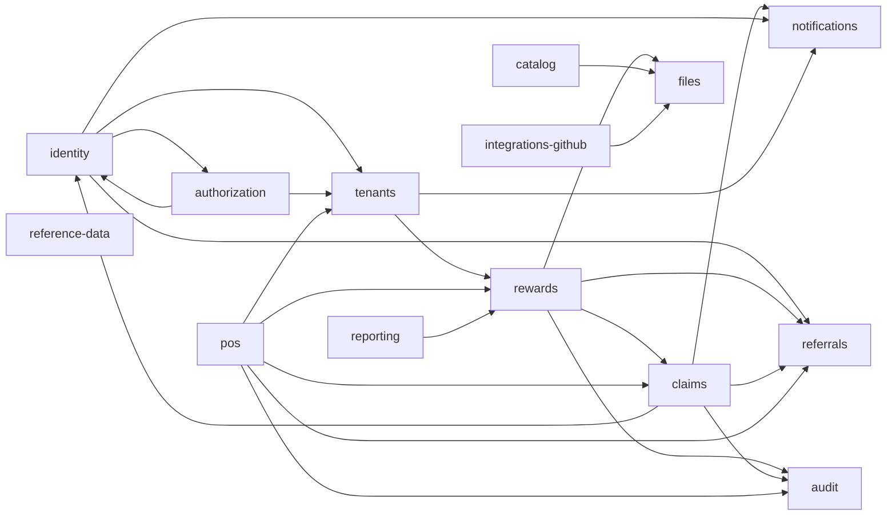

# Context map

The API is one process (ADR 058). A box is a bounded context under `apps/api/src/contexts/<name>/`. An arrow is a call through that context's `public-api.ts`, or an outbox event (ADR 015, ADR 060). Platform code under `apps/api/src/platform/` is shared infrastructure, not a fifteenth business context.

| Context | Owns | Talks to |
| --- | --- | --- |
| identity | Users, sessions, passwords, MFA, impersonation | authorization (role assignment at provisioning), tenants, referrals (first code at signup), notifications |
| authorization | Roles, permissions, Cedar policies, support access | identity (session revocation in the RBAC transaction), tenants (support access: existence, ownership, audit rows, through `createTenantsTransactionalPorts`) |
| tenants | Tenants, locations, membership, the merchant profile's POS policy | rewards, notifications; consumes pos's `API_KEY_CAPABILITIES` and `STORE_CLOSURE_FACTORY` by token (pos implements them, so tenants never imports pos); provides the platform's `MERCHANT_TENANT_RESOLVER` (a member's tenant from the route's slug, for `MerchantActorInterceptor`) |
| rewards | Reward lifecycle, KYB evidence | claims, files, audit; provides referrals' `SIGNUP_REFERRAL_AUDIT_FACTORY` by token (`RewardsAccessModule`, a global leaf), so referrals never imports rewards |
| claims | A customer's claim, its OTP and QR codes, the reward inbox (every notice, a referrer's signup-success notice included), a credited referrer's credit claim and email | rewards (stock, legal, audit, titles), identity (claimant row and address, a referee's name), referrals (attribution, credit-email and signup-notice bookkeeping), tenants (owners), notifications |
| pos | Checkout (validate, checkout, backup-code lockout), terminals and pairing, merchant API keys and their verification, the redemption history | claims (find and redeem claims), rewards (redemption counters, titles, audit), referrals (credit, signup success), tenants (merchant access, POS policy, till facts) — all bound to the checkout's own transaction |
| referrals | Signup referral codes and dashboards; reward referral credit (`ReferralCreditPort`, in pos's checkout transaction) | — (a leaf: identity depends on it, so it imports no context, and it writes only its own tables). Pos wires rewards' inventory in as its `ReferralBonusStockPort`; rewards provides its code-job audit writer by token; claims consumes `ReferrerCredited` / `SignupReferralSucceeded` and their bookkeeping ports. |
| reporting | Dashboards and exports | rewards |
| files | Stored objects and scan verdicts | notifications |
| notifications | Email log and delivery | outbox |
| catalog | Products and sample categories | files |
| reference-data | Countries, regions, cities | — |
| audit | The HTTP and domain audit trail | — |
| integrations-github | Linked accounts, pull requests, webhooks | files |

`rewards/runtime` is gone: claims, pos and referrals each own their part. The live state and the remaining work are in `ddd-cqrs-handoff.md` §0.

## Wiring rules

- **Files.** Files owns no category meaning. Each owner registers its own access rule, reference guard and in-transaction bindings from its module, and files imports no context:
  - tenants: store branding and KYB
  - rewards: reward images, through tenants' `TENANT_FILE_ACCESS`
  - identity: avatars
  - integrations-github: comment images
  - catalog: product images
- **Public APIs.** A `public-api.ts` exports only leaf Nest modules, meaning modules that depend on platform alone. Composition modules that wire other contexts are mounted only by `app.module.ts`. Identity and authorization are `@Global` and reach each other through tokens. This keeps the module graph acyclic without `forwardRef`.
- **Pos.** `PosAccessModule` (global leaf) provides `API_KEY_VERIFICATION` and `TILL_RESOLVER` (platform ports the security kit's `ApiKeyAuthGuard` and `MerchantApiKeyGuard` use) and tenants' `API_KEY_CAPABILITIES` and `STORE_CLOSURE_FACTORY`. The checkout is one unit of work: claims' `ClaimRedemptionPort` (claims locked first, in claim-id order), rewards' inventory (every line reward and its referrer child locked in one id-ordered pass by `lockForCheckout` before any write) / facts / audit, referrals' `ReferralCreditPort` (with rewards' inventory as its bonus stock) and tenants' POS policy, all on the checkout's transaction and under the till key's `api_key` RLS principal.
- **Referrer credit.** Referrals credits the referral and records `ReferrerCredited`; claims issues the credit claim and inbox notice in the same transaction (mechanism 1) and requests the email after the commit as a system operation, with a BullMQ sweeper for the backlog. Claims holds the email because it can reach the referrer's address through identity; referrals cannot (identity already depends on referrals). `SignupReferralSucceeded`'s notice is delivered after the commit by claims too (it owns the inbox and reads the referee's name through identity), claiming it through referrals' `SignupSuccessNoticesPort`, as a system operation: the till's key may neither read the referee's name nor write the referrer's inbox. Both follow-ups are durable without being in the checkout transaction: the owed state commits with the credit and a sweeper retries it (plan §7.4 said "during checkout"; the deviation is recorded in `ddd-cqrs-handoff.md` §0.9).
- **Referrals stays a leaf.** Identity depends on referrals, so referrals imports no context. What it needs from others arrives inverted: its code-job audit writer by token from rewards (`SIGNUP_REFERRAL_AUDIT_FACTORY`), and its bonus stock wired in by pos; its follow-ups are delivered by claims.
