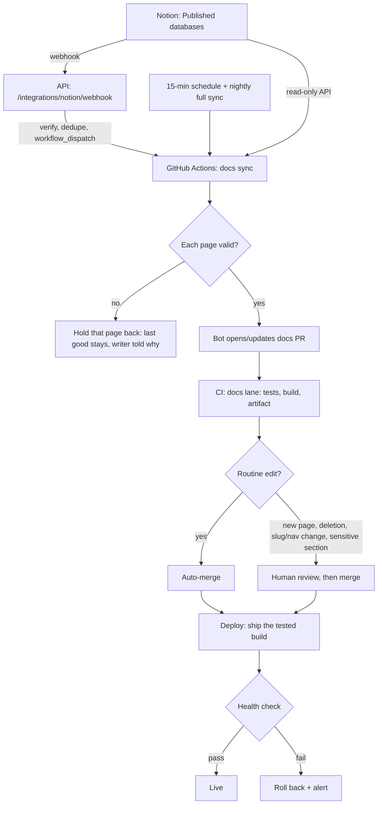

# Notion docs plan

**Status:** approved plan; **phase 1 built 2026-11-05** (the TanStack Start site, not yet committed); phase 2 (Notion) not started. Agreed 2026-11-02; revision 2 merges an external review. When it
ships it is recorded as ADR 075 (the next free number). After the import in phase 2, this page moves to
Notion like every other doc.

## 1. The decision in brief

1. **Notion is the only place docs are written:** the user guide, technical docs, architecture, ADRs and
   the blog. There is no repo-Markdown fallback; every product built from the starter needs a Notion
   workspace. **Agent instructions and the generated API reference stay in the repo.**
2. **Publishing is controlled in Notion and checked in GitHub.** Only publishers can edit the Published
   databases (Notion enforces it). A sync bot turns published pages into Markdown and opens a
   **docs-only pull request**. Routine edits to existing pages merge automatically once checks pass; new
   pages, deletions, slug or navigation changes and sensitive sections wait for a human review.
3. **The docs site is rewritten in TanStack Start.** Every page is pre-rendered; a small Start server
   handles redirects and the 404 page.
4. **GitHub Actions builds the site once; the Droplet only runs it.** The exact build that passed the
   checks is shipped to the platform's DigitalOcean Droplet, activated atomically, health-checked, and
   rolled back automatically if it fails.
5. **Writers publish without Git or an engineer.** A routine edit is live within **5 minutes at the
   median and 8 at the 95th percentile**. These are derived from measured stages and confirmed in the
   pilot (§5).

**Success looks like:** a writer publishes in Notion; the change goes live without them touching Git or
asking anyone. When something is wrong, they get a message they can act on ("the toggle on page X holds a
database, which isn't supported; replace it with a table"). The site keeps serving the last good version
of that page, and an operator can trace any live page back to its Notion page, sync run, pull request and
deployed build.

## 2. What lives where

| Content or system | Written in | Notes |
|---|---|---|
| User guide, technical docs, architecture, ADRs, blog | **Notion** | Synced into the repo as generated Markdown |
| `AGENTS.md`, `CLAUDE.md`, `rules/`, `.claude/skills/` | **Repo** | Never synced from Notion: agents obey them, so they keep normal code review |
| `docs/generated/` (OpenAPI, API samples) | **Repo**, generated from code | Notion cannot produce them |
| Glossary terms (`GLOSSARY_TERMS` in the renderer) | **Repo** | Today a hard-coded list in the renderer's code; a Notion Glossary database is out of scope (§16) |
| Site code: TanStack Start app, renderer, plugins, tests | **Repo** | |
| Generated Markdown, manifest, `docs/meta.json`, redirects, search index | **Repo**, generated | Edits by anyone but the sync bot are rejected by CI |

- Every generated file starts with a header naming its Notion page ID and URL: *"Generated from Notion,
  edit there: &lt;link&gt;"*.
- **Docs still change with the code.** Pull requests that change behaviour carry a required line,
  *"Docs: updated in Notion &lt;link&gt;"* or *"Docs: not needed, &lt;reason&gt;"*, and CI fails without it. It's a
  process signal, not proof the docs are right. `AGENTS.md` and `rules/14-documentation.md` say so.

## 3. Notion structure and who can publish

Notion can restrict who edits a **database**, but not who changes a **property value**: anyone who can edit
a page can change its Status. So "only publishers can publish" is enforced by structure, not by a Status
option:

| Database | Who can edit | What it holds | Synced? |
|---|---|---|---|
| **Docs Drafts** | Writers and publishers | Pages being written: status *Draft* or *In Review* | Never: the integration isn't shared with it |
| **Docs Published** | **Publishers only** | Live pages: status *Published* or *Archived* | *Published* pages only |
| **Blog Drafts** | Writers and publishers | As Docs Drafts | Never |
| **Blog Published** | **Publishers only** | As Docs Published | *Published* pages only |

- **Publishing** is moving a page from Drafts to Published (Notion keeps the page and its history). An
  edit to a live page is made in Published, by a publisher, or drafted in Drafts and moved over.
- **Archived** takes a page off the site but keeps it in Notion.
- The workspace has a named **owner and a backup owner** (by role), recorded in ADR 075, before
  production.

### Properties

| Property | Docs | Blog | Rule |
|---|---|---|---|
| Title | Required | Required | |
| Slug | Required, unique | Required, unique | The URL; error if missing or duplicated |
| Section, Order | Required | — | Generate the sidebar (`docs/meta.json` becomes generated) |
| Description | Required | Required | Search snippets and sharing text |
| Author | Optional | Required | |
| Tags / Category | Optional | Category required | |
| Last updated / Date | From Notion's edit time | Explicit publish date | |
| Status | Required | Required | |
| Page icon | Optional | Optional | Shown in the sidebar and page header |
| Page cover | **Optional** | **Required** | See "Covers and sharing images" in §6 |

### Access

A Notion **internal integration** with **read content** only, shared with the two **Published** databases
and nothing else: drafts are never visible to it. Its token is a GitHub Actions secret, plus a local
`.env` value for a manual sync. It is never committed or printed.

## 4. Publication flow and review policy



### Pull requests, not direct pushes

- The bot is a **GitHub App** with short-lived installation tokens, never a person's token. It can push
  only to its own `notion-sync/*` branches and open or update pull requests.
- Each sync updates **one** open docs pull request (or opens it), so rapid edits don't pile up.
- A CI check enforces that the pull request touches **only Notion-owned paths**: `docs/**` except
  `docs/generated/`, `docs/assets/notion/`, and the generated manifest, sidebar and redirects.
- **Auto-merge** applies only when every change in the pull request is a routine edit to an existing page.
  **Human review** is required when the pull request:
  - adds or removes a page;
  - changes a slug, a section or the order (navigation);
  - adds a redirect;
  - touches a **sensitive section**: by default `adr/`, `architecture/` and `technical/security/`. The
    final list is recorded in ADR 075.
- **How auto-merge fits the branch rules.** `main` today requires passing checks **and one approving
  review** (`docs/technical/operations/ci.md`). Two rulesets keep that:

  | Ruleset | Requires | Who may bypass |
  |---|---|---|
  | Checks | Every required status check, an up-to-date branch | **Nobody**, including the bot |
  | Review | One approving review | **Only the docs GitHub App**, which then auto-merges only routine pull requests (the rule above is checked in CI) |

  If the organisation won't allow that bypass, every docs pull request waits for a reviewer and writers
  lose self-service. That trade-off is recorded in ADR 075.

### Required checks without running the full suite

Skipping `ci.yml` for docs-only pull requests with `paths-ignore` would leave its required checks
**waiting forever** (GitHub doesn't report a skipped workflow). Instead:

- `ci.yml` starts with a **changes** job that classifies the pull request.
- For a docs-only pull request, the code jobs (lint, typecheck, unit tests, e2e, browser e2e, build) are
  **skipped by condition**. GitHub reports a skipped job as passing, so the required checks are satisfied.
- A **docs lane** job runs instead (§5).
- Any change outside Notion-owned paths runs the **full suite**, as today. The classification itself has
  tests, so a path filter can never skip a check it shouldn't.

Why skipping is safe: the only tests that read Notion-owned files are `apps/docs`'s own (checked across
every package; the other mentions of `docs/` are a URL string in an API test and a comment in a lint test),
and the docs lane runs those. Code reaches `main` only through pull requests that pass CI and are up to
date, so the code a docs pull request sits on is already tested.

## 5. Latency budget

**Requirement:** from a page being published (or a published page being edited) to the change being live,
with a passing health check:

- **median ≤ 5 minutes;**
- **95th percentile ≤ 8 minutes;**
- an operations alert if any publish takes **more than 15 minutes**.

Every stage logs a timestamp, so phase 5's pilot measures the real figures. If a stage is slow, it gets
faster without dropping a check.

| # | Stage | Time | Source |
|---|---|---|---|
| 1 | Notion sends the webhook | ≤ 60 s (target) | **Not measured yet:** Notion groups rapid edits before sending |
| 2 | API verifies and dispatches | < 1 s | One HTTPS call |
| 3 | Collapse window (more edits join the run) | 30 s | Chosen |
| 4 | Runner picks up the job | 5–20 s | **Not measured yet** |
| 5 | Checkout + cached install | ~40 s | **Measured**: 5 s + 33 s in this repo's CI |
| 6 | Fetch changed pages and images | ~2–10 s | Derived: ~1 request per page, +1 per 100 blocks, +1 per image, at Notion's ~3 requests/s |
| 7 | Convert, validate, push branch, open the pull request | ~10–20 s | Estimate |
| 8 | Docs lane: checkout + install, `apps/docs` tests, link check, build, upload the build | ~1.5–2 min | **Measured parts**: install 38 s, build 21 s locally, link check 0.3 s |
| 9 | Auto-merge | ~5–15 s | GitHub merges once checks report |
| 10 | Ship the build to the Droplet, switch, reload, health check | ~20–40 s | Derived: one build is 73 MB, mostly HTML that compresses well |
| | **Total** | **~4–5.5 min** | Stages 1, 5 and 8 dominate |

The earlier draft, which deployed only after the full CI, could not meet this: the full CI measured
**12–18 minutes** (median 16.6 over 11 recent successful runs).

## 6. The sync engine

A standalone package that doesn't depend on TanStack Start or React, so it can be tested on its own:

```text
packages/
  docs-content/     contracts, page identity, manifest, validation rules
  docs-sync/        Notion client, pagination, conversion, assets, reconciliation, CLI (pnpm docs:sync)
  docs-renderer/    Markdown → HTML: the existing remark/rehype plugins
apps/
  docs/             TanStack Start: routes, search, server
```

### Invariants

1. **Repeatable:** the same Notion input, converter version and settings produce byte-identical output
   (timestamps normalised).
2. **No noise:** an unchanged sync changes nothing and opens no pull request.
3. **Pages are identified by their Notion page ID**, never by title or slug.
4. **A failed page keeps its last good version.**
5. **One bad page doesn't block the others.**
6. **Workspace-level problems block the batch:** duplicate slugs, a broken sidebar, a corrupt manifest,
   or a file path that escapes its folder.
7. **Nothing is skipped after a failure:** "synced up to here" advances only after the change is merged.
8. **Rebuildable:** a full sync can recreate the whole generated state from Notion, without relying on
   history.

### Manifest

`docs/generated-notion/manifest.json` (schema-validated and versioned) maps each Notion page ID to:
- its slug and previous slugs (which drive the redirects);
- its file path;
- a content hash and the converter version;
- its Notion edit time and the last sync run.

File paths are never built from raw titles or slugs: they are strictly normalised and checked for
collisions.

### One bad page is held back, not the whole sync

When a page has an unsupported block or fails validation:
- its last good Markdown and assets stay as they are;
- the run records the page ID, the block ID and type, the reason and the fix;
- every other page still publishes;
- the page shows as **held back** in the Operations console, and its author and publisher are told what
  to change.

Nothing is silently dropped.

### Fetching from Notion

- Child blocks are fetched **recursively**, following pagination at every level.
- Requests stay within Notion's limit (about 3 per second) with limited concurrency, retries with
  exponential back-off and jitter, and respect for its rate-limit responses.

### Block support

A **versioned support matrix**. A block counts as supported only once it has fixtures built from real
Notion API responses, and conversion tests.

| Notion block | Becomes | Phase 2 |
|---|---|---|
| Paragraph, headings, bulleted/numbered lists, to-do, rich text, inline code, quote, divider | Markdown | Supported |
| Callout (icon or colour picks the kind: ℹ️ info, ⚠️ warning, ⛔ danger, ✅ tip) | `> [!KIND] …` | Supported |
| Code block (Mermaid → diagram; other languages highlighted) | ` ```lang ` | Supported |
| Table; a table whose rows are images | Markdown table; screenshot gallery | Supported |
| Image, file, PDF, video | Downloaded asset; the site's PDF/media embeds | Supported |
| Bookmark, link to another Notion page | Link; the linked page's site URL | Supported |
| Toggle | `<details><summary>` | Supported |
| Equation | Rendered maths | Supported if the renderer adds maths support in phase 1; otherwise the page is held back |
| Columns, synced blocks, child pages, inline databases, embeds, forms | — | **Page held back** with a clear message, until each gets a tested mapping |

### Covers and sharing images

- **Blog posts:** a cover is **required**. A post without one is held back, because posts are what people
  share.
- **Docs pages:** a cover is **optional**. A missing cover never blocks a fix.
- **Every page** gets a 1200×630 **sharing image** (Open Graph and Twitter):
  - cropped from the cover when there is one;
  - otherwise generated from the title, section and the site's brand.

### Assets

- Notion's file links expire after an hour, so every image and file is **downloaded** and stored by
  content hash in `docs/assets/notion/`. The manifest records which pages use each one.
- **The downloader is locked down:**
  - HTTPS only;
  - Notion's file hosts only;
  - redirects checked at every hop;
  - **private, loopback and link-local addresses refused**, so a page can't make the sync fetch an
    internal address (SSRF);
  - a size cap and a timeout;
  - the content type and file signature must agree.
- **Deletion is two-step:** first mark everything still in use, then delete only what nothing references.
  "In use" covers any published page or retained release.

## 7. Slugs, redirects, links and deletion

- **Slugs are unique** across everything published.
- **A changed slug adds a permanent redirect** from the old URL, generated from the manifest's slug history
  into `apps/docs/generated/redirects.json`. The redirects are checked:
  - no duplicate sources;
  - no loops;
  - no redirect to a missing page;
  - no clash with a live URL;
  - an end-to-end test of a renamed slug in the built site.
- **Links between Notion pages** resolve by page ID and are rewritten to the site URL. A broken internal
  link names both the page with the link and the page it points to.
- **External links** that don't answer are a **warning**, so another site's outage never blocks publishing.
- **Unpublishing or deleting a page** happens only after its links and redirects are checked. A page still
  linked from another published page can't be removed until that link is fixed, or pointed to an approved
  replacement page. Removed pages leave a record (page ID, last slug) for redirects and auditing.

## 8. Validation levels

| Level | Effect | Examples |
|---|---|---|
| **Error** | That page doesn't update (workspace-level errors block the batch) | Missing or duplicate slug; unsupported block; broken internal link; blog post without a cover or description; unsafe path |
| **Warning** | Publishes, shown to the writer and in the Operations console | Docs page without a cover (generated sharing image used); an external link not answering |
| **Info** | Publishes; editorial advice | Whitespace or heading-level tidied up |

## 9. The new docs site (TanStack Start)

### Order of work

**Migrate first, then connect Notion.** In phase 1 the site moves to TanStack Start while still reading
the repo's Markdown, against a **regression baseline** captured from the current Astro site:
- every URL;
- each page's rendered HTML for a representative set;
- link-check results;
- search results.

Notion is connected in phases 2–3, on a renderer already proven to match. A new framework and a new
converter are never introduced in the same untested step.

### Rendering

```text
Notion blocks → Markdown + front matter (sync) → remark → rehype → React components → pre-rendered Start routes
```

- The existing plugins move into `packages/docs-renderer` **unchanged, with their tests**. Inventory, from
  `apps/docs/astro.config.ts`:
  - remark: `remarkCallouts`, `remarkGlossary`, `remarkImageGallery`, `remarkImageUrls`,
    `remarkDiagrams`, `remarkStripFirstHeading`, `remarkTaskMarkers`, `remarkContentLinks`,
    `remarkMediaEmbeds`, `remarkPdfEmbed`, `remarkQrCode`;
  - rehype: `rehypeCodeBlock`, `rehypeHeadingIds`, `rehypeHeadingAnchors`, `rehypeExternalLinks`,
    `rehypeTableWrapper`;
  - the code-block highlighter (`preloadCodeBlockHighlighter`) and the API reference.
- **Every page is pre-rendered at build.** The Start server renders on request only:
  - slug redirects;
  - search URLs;
  - the 404 page.

  Interactive parts (diagrams, glossary tooltips) are checked for correct server rendering and hydration.

### TanStack products

| Product | Job | When |
|---|---|---|
| Start + Router | Pages, typed URLs, pre-rendering, search terms in the URL | Phase 1 |
| Query | Loading the search index and the API reference on demand, with caching (static page data doesn't need it) | Phase 1 |
| Table | The API reference: endpoints, parameters, error codes, with sort and filter | Phase 1 |
| Pacer | Debouncing the search box | Phase 1 |
| Virtual | Long lists (the endpoint list, search results) **once a measurement shows a list needs it** | When measured |
| Store | Not used: local state is enough until state is genuinely shared across routes | — |
| Form, DB, Ranger, AI | Not used (the feedback form is out of scope, §16) | — |

### SEO and accessibility

Generated at build:
- `sitemap.xml`, `robots.txt` (explicit indexing policy) and canonical URLs;
- per-page title, description, Open Graph and Twitter tags with the 1200×630 sharing image;
- the blog's RSS feed;
- breadcrumbs with structured data;
- the search index.

Images need alt text (a warning if missing). Keyboard navigation, visible focus, contrast in both themes,
and respect for reduced motion are tested.

### Identity

The docs get **their own identity**, with a palette and typography unrelated to the apps. **Three
directions are mocked up** (editorial and calm, technical and precise, warm and friendly), alongside
phase 1's engineering. One is chosen and built, in light and dark, phone to desktop.

### TypeScript

`apps/docs` is held on TypeScript 6 only because `astro check` doesn't support 7. After Astro is removed
and the new app passes typecheck, the hold, its syncpack group and its notes in `docs/technical/tooling/`
are removed, and the supported version is recorded in the tooling docs.

### Versioned docs

Deferred. The latest docs live at the canonical URLs. Version snapshots (the API reference and migration
guides first) are decided before a product's first stable release. No `/v1/` routes exist until that
lifecycle is built.

## 10. Hosting and deployment

### Where it runs

- **The platform's existing DigitalOcean Droplet**: one more **pm2** app (the Start server), behind
  **nginx** with **certbot** certificates, at `docs.<domain>`. The domain is a setting each product fills in.
  Only data services (Postgres, Redis and similar) run in Docker.
- **The Droplet only runs the site; GitHub Actions builds it.** The build never competes with the
  platform for CPU, and the live site is exactly what passed the checks.
- **Capacity check before go-live:** measure the Droplet's normal and peak CPU, memory and disk, and set
  resource alerts. If the headroom isn't there, the docs move to their own small Droplet (a config change,
  since the build already happens elsewhere).
- The docs deploy never runs migrations or restarts the API or web apps.
- This departs from the App Platform design in `docs/technical/starter-kit-production-roadmap.md` for the
  docs site. The platform's own deployment is a separate decision.

### Build provenance: what was tested is what ships

- The docs lane builds the site and uploads it as an artifact keyed by the commit's **git tree hash**,
  with its SHA-256.
- `main` requires branches to be up to date, so the merge commit's tree is the tree that was tested. After
  merging, the deploy job finds the artifact for that tree. If it isn't there (for example, a merge queue
  changed the tree), it builds one from the merged commit.

### The deploy command

GitHub Actions connects over SSH with a **dedicated key that can run exactly one command**: no shell, no
port or agent forwarding. The Droplet's host fingerprint is pinned in a secret. The command,
`deploy-docs receive <commit> <sha256>`, reads the build from standard input and:

1. checks the commit is a full SHA and the upload stays under the size cap;
2. checks the upload's SHA-256;
3. unpacks it into `releases/<commit>` (never outside it);
4. verifies the expected files and manifest are present;
5. atomically switches the `current` link;
6. reloads **only** the docs pm2 process;
7. runs the health check: the server answers, reports the expected commit, and a representative page,
   an asset and the search index load;
8. on any failure, switches back to the previous release, reloads, confirms the rollback, and exits with
   an error.

The error raises an operations alert. Only one deploy runs at a time, and a newer one replaces a queued
older one only if it also passed CI.

The Droplet needs **no access to the repository**: no checkout and no deploy key. This assumes Start's
production build bundles its server dependencies (to be verified in phase 1). If it doesn't, the build
includes a production `node_modules` installed from the lockfile.

### Release retention

- One build is **73 MB**, measured on today's site (62 MB of it HTML; the images are only 4.5 MB, so
  storing assets once saves little). Keeping the **last 20 releases** is about **1.5 GB**.
- Retention never deletes the live release or the last known good one.
- A disk alert fires well before the Droplet's threshold.
- A written manual recovery procedure covers the case where an automatic rollback itself fails.

### Server setup

A written guide (no infrastructure code) covers:
- a DigitalOcean firewall allowing 80/443 and SSH;
- SSH with keys only (no passwords, no root login);
- automatic security updates;
- a non-root app user;
- nginx and certbot;
- the pm2 entry;
- the docs health endpoint;
- the **`server-agent`** (`apps/server-agent`, which feeds the Operations console from ADR 068), so the
  Droplet's CPU, memory, disk and up/down state are watched.

This plan links to the guide rather than repeating it.

## 11. The webhook receiver

The **existing API** receives Notion's webhook. It is already public, monitored by the `server-agent`,
manages its secrets and raises operations alerts, so no new service is needed. The endpoint:

- verifies Notion's signature over the raw request body, and handles Notion's first-time verification
  handshake;
- checks the event's shape and rejects anything malformed;
- **ignores duplicate events** (by event ID), so dispatching twice is harmless;
- starts the sync with **`workflow_dispatch`** on one fixed workflow and branch, passing nothing taken
  from the request;
- replies at once: it never fetches from Notion or converts anything;
- records each delivery and dispatch without logging secrets or full payloads.

Why `workflow_dispatch` rather than `repository_dispatch`: `workflow_dispatch` needs only the **Actions**
permission, while `repository_dispatch` needs **contents: write**, which could push code.

Webhooks are not trusted for correctness: a 15-minute sync catches missed events and a nightly full sync
repairs drift.

## 12. Secrets

| Secret | Held by | Can do | Owner / rotation |
|---|---|---|---|
| Notion read token | GitHub Actions; a local `.env` for manual syncs | Read the two Published databases | Platform owner; every 90 days and on exposure |
| Notion write token (temporary) | The import operator's machine, phase 2 only | Create the imported pages | Import operator; **revoked straight after the import** |
| Notion webhook signing secret | API | Verify webhooks come from Notion | Platform owner; on exposure |
| Dispatch credential (a GitHub App, or a fine-grained token) | API | Start the sync workflow (Actions permission only) | Platform owner; prefer short-lived App tokens |
| Docs bot GitHub App key | GitHub Actions | Push `notion-sync/*` branches, open and update pull requests, merge routine ones under the rules in §4 | Repository owner; on exposure |
| Deploy SSH key + pinned host fingerprint | GitHub Actions | Run `deploy-docs receive` on the Droplet, nothing else | Infrastructure owner; every 90 days and on exposure |

- Owners are named by role in ADR 075, and rotation and revocation are rehearsed before production.
- No secret or authorisation header is ever printed.
- The Droplet holds **no** repository credential.

## 13. Observability and alerts

Each sync has a **sync-run ID**, and records:
- the trigger and event ID;
- each stage's start and end;
- pages processed, unchanged, held back and removed;
- content hashes and the converter version;
- errors and warnings;
- the pull request URL and merge commit;
- the deployed commit and the deploy or rollback result.

The **Operations console** shows:
- the latest attempted and successful syncs;
- runs in progress and failed runs;
- **held-back pages** with the block-level reason;
- the pull request and its checks;
- the live commit against the latest merged commit;
- deploy and rollback history;
- Notion rate-limit and webhook-dispatch failures;
- the Droplet's disk and the release storage.

**Alerts** reach SuperAdmins in the app, by push and by email; these channels already exist (ADR 070). A
repeated failure raises one alert, not one per run, and it resolves itself on the next good run. A writer
whose page is held back is told by email and in the app, in words they can act on.

**Reconciliation** compares four things:
1. Notion's published pages and their edit times;
2. the repo's manifest and content hashes;
3. the latest merged commit;
4. the live release.

The nightly full sync reports any drift.

## 14. Tests and release gates

| Kind | Covers |
|---|---|
| Unit | Each block converter, rich text, slug normalisation, validators, manifest and redirect generation |
| Contract | Real Notion API response fixtures, pagination, nested blocks |
| Integration | The Notion client, webhook signature checks, the bot's pull request flow, the asset downloader |
| Repeatability | An unchanged sync gives identical output and no pull request |
| Concurrency | Duplicate and out-of-order events, overlapping runs, the deploy lock |
| Failure and recovery | Rate limits, timeouts, malformed blocks, one failed page, a failed build, rollback |
| Security | SSRF, unsafe Markdown, HTML and URLs, secret leakage, workflow permissions, path traversal, the deploy command's argument checks |
| Regression | Every current URL, rendered pages, embeds, search (against the phase 1 baseline) |
| End to end | Publish in Notion → sync → pull request → checks and review policy → merge → deploy of the tested build → health check |
| SEO and accessibility | Sitemap, canonical tags, sharing tags, keyboard use, focus, contrast, alt text |
| Performance | A large workspace sync, build time, search, Droplet headroom |

**Invariants that each have a test:**
1. A failed page keeps its last good version, and the others publish.
2. Workspace-level collisions or unsafe paths block the batch.
3. Unchanged input makes no commit.
4. A renamed slug redirects end to end.
5. A broken link names both pages.
6. Removing a page never deletes an asset still in use.
7. Only the tested build is deployed.
8. A failed health check restores the previous release.
9. A full sync rebuilds the generated state from Notion.
10. Every error traces to a sync run, page and block.

**Every phase passes the repository's full gate before the next starts**, with each command exiting 0
after the final change:

```bash
pnpm run format
pnpm run lint
pnpm run typecheck
pnpm run test
pnpm run test:e2e
pnpm run ci:local
```

## 15. Phases

| # | Phase | Done when |
|---|---|---|
| 1 | **Baseline and TanStack Start migration:** capture the regression baseline; inventory routes, plugins and embeds; move the plugins into `packages/docs-renderer`; build the Start app on the repo's Markdown (pre-rendering, search, API reference, SEO, accessibility); check Start's build bundles its server dependencies; remove Astro and the TypeScript 6 hold. **In parallel:** three design directions → choose → build | Every current URL and baseline page renders the same; the design ships in both themes; the full gate passes |
| 2 | **Sync engine and import:** `packages/docs-content` and `packages/docs-sync` (Notion client, recursive pagination, rate limits, conversion, assets, manifest, slug history, redirects, held-back pages, full sync); the four Notion databases and the public template; import the 186 docs and the blog with the temporary write token, review the differences, revoke the token | A local sync rebuilds the site from Notion with no unreviewed differences; an unchanged sync changes nothing; held-back pages keep their last good version |
| 3 | **Publication automation:** the webhook endpoint; `workflow_dispatch`; the 15-minute and nightly syncs; the docs bot GitHub App and its pull requests; the routine-or-review classifier; the two rulesets; the `changes` job and docs lane in `ci.yml`; the generated-paths guard and the "Docs:" line check; sync-run records; writer and operator notifications | Publishing in Notion opens a checked pull request; routine edits merge on their own, the others wait for review; a missed webhook is caught by the scheduled sync |
| 4 | **Deploy and operations:** capacity check; nginx, certbot, pm2, the non-root user; artifact by tree hash; `deploy-docs receive` with releases, the atomic switch, health check and rollback; retention and the disk alert; the pinned host key; the Operations console views and alerts; a rollback rehearsal | Only a tested build can go live; a failed health check rolls back; the docs deploy never touches the platform; resource and disk alerts fire |
| 5 | **Pilot and rollout:** a few pages and writers first; measure the latency budget and failure rates; confirm writers publish without Git; expand to everything; rehearse secret rotation; update `AGENTS.md`, `rules/14-documentation.md` and the pull request template; write ADR 075 | The median is ≤ 5 min and the 95th percentile ≤ 8 min over real edits (or an approved exception is recorded); operators can find and fix failures; the full gate passes |

## 16. Out of scope

- Two-way sync, or editing Notion content from the repo.
- Notion as a source for agent instructions or security rules.
- Automatic deployment of the platform itself (API, web apps).
- The "Was this helpful?" feedback form: it needs a public, rate-limited endpoint, abuse controls, an
  audit policy and an admin page.
- Version routes (`/v1/`…) until the versioning policy is built.
- A Notion Glossary database: glossary terms stay in the renderer's code.
- Notion embeds or block types without a tested mapping and a security review.

## 17. Recorded in ADR 075 before phase 3

1. The Notion workspace owner, the backup owner and the publishers (by role).
2. The final list of sensitive sections that always need human review.
3. Whether the organisation allows the docs bot to bypass the review rule (otherwise writers lose
   self-service).
4. The Droplet's measured headroom.
5. The measured latency, against the target in §5.

## 18. Risks and trade-offs

| Risk | How it's handled |
|---|---|
| A publisher's edit goes live without a Git review | Only publishers can edit the Published databases; routine edits only; new pages, deletions, navigation and sensitive sections always get a human review |
| The bot's review bypass is misused | It applies only to pull requests the classifier marks routine, touching only Notion-owned paths; required checks can't be bypassed by anyone |
| Notion changes its API or adds blocks | Versioned converters with real fixtures; affected pages are held back with their last good version |
| Writers forget covers | Docs pages get a generated sharing image; only blog posts require a cover |
| The shared Droplet runs short | The build happens in GitHub Actions; capacity check and resource alerts; moving to a separate Droplet is a config change |
| Release storage grows | 20 × 73 MB ≈ 1.5 GB measured; retention and a disk alert |
| Docs drift from the code | The required "Docs:" line plus reconciliation; a signal, not proof |
| The wrong build is deployed | The artifact is keyed by tree hash and checked with SHA-256; one deploy at a time; the Droplet has no repository access |
| The webhook receiver fails | Scheduled and nightly syncs; dispatch failures alert |
| The latency target is missed | Per-stage timestamps show where; each stage gets faster without dropping a check |

---

**Principle:** Notion owns the writing; the repo owns instructions and rendering code; the sync engine
owns a repeatable transformation; GitHub owns checks and history; the deploy owns going live; the
Operations console owns visibility and recovery. Each boundary has one job and leaves an audit trail.
