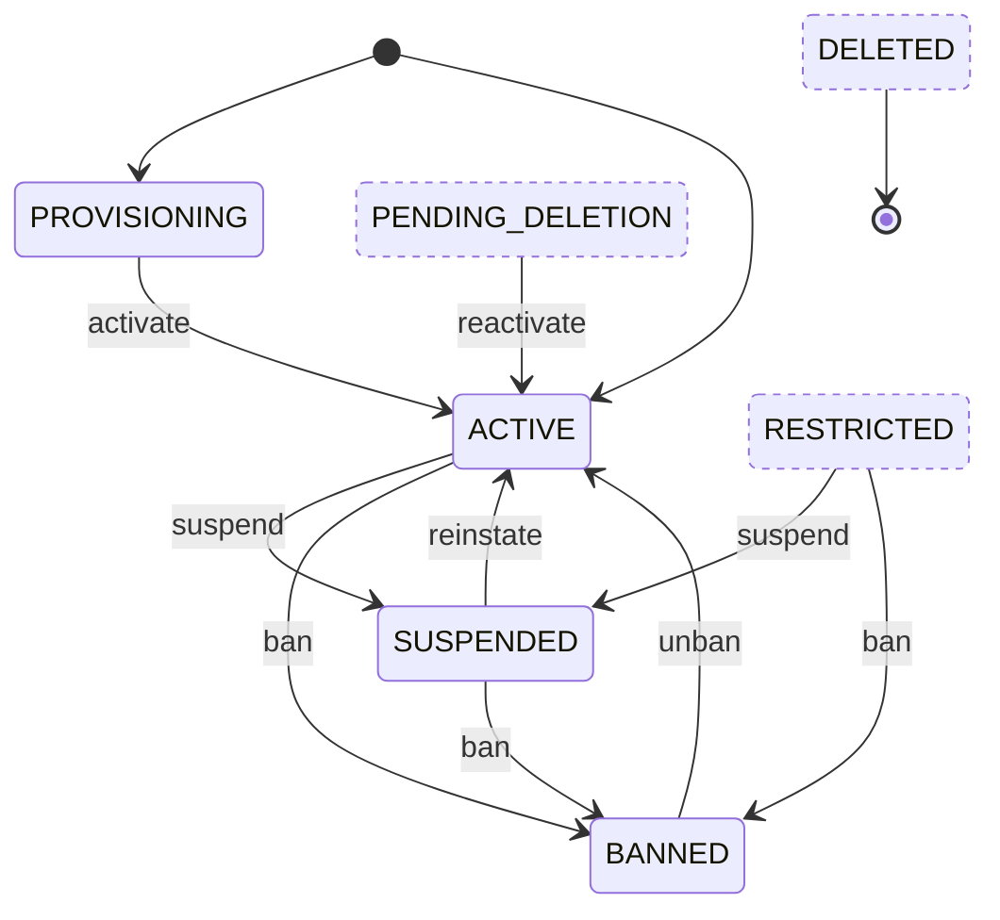
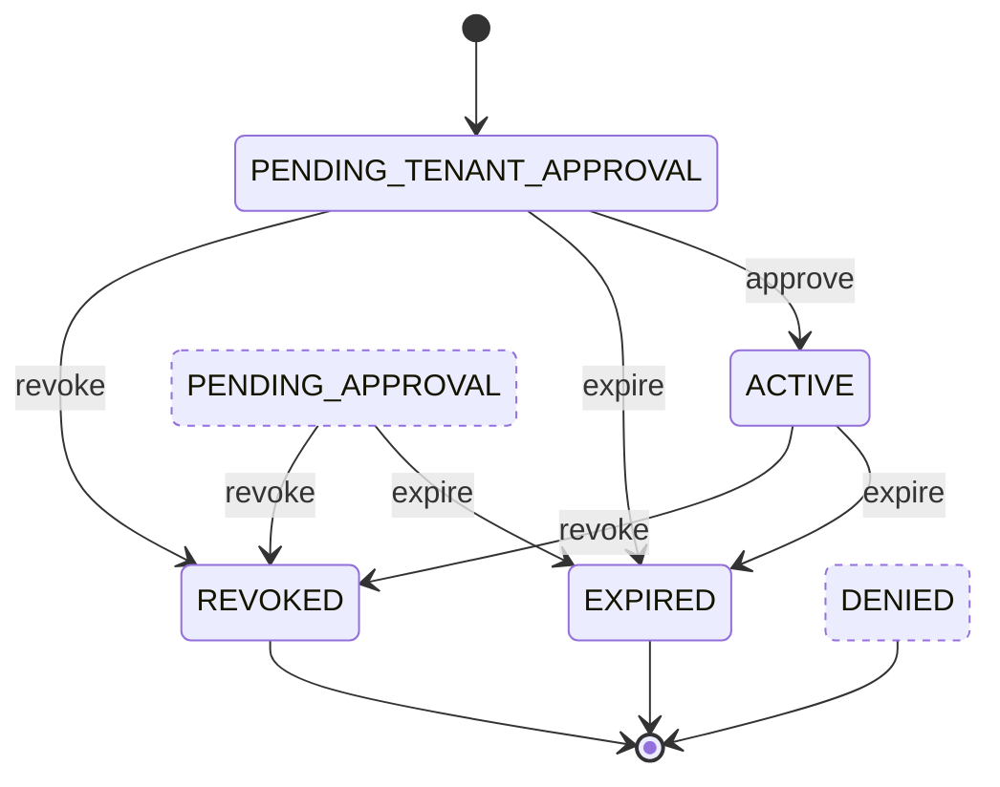
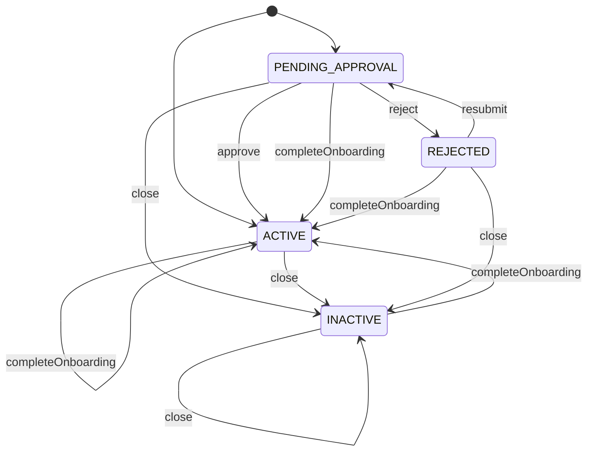
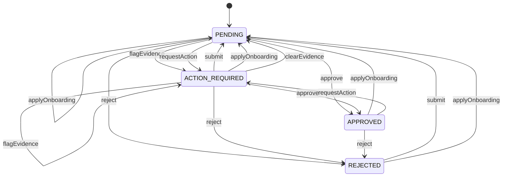
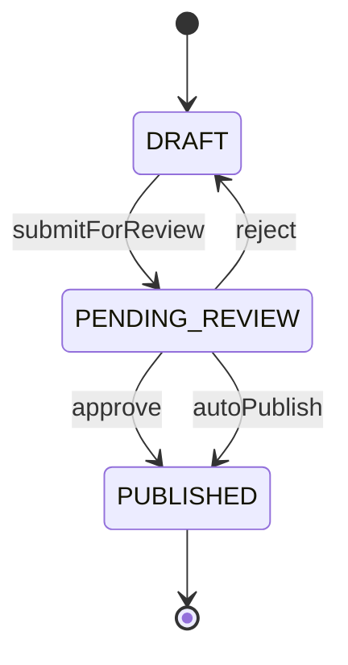

# State machines

A row with a `status` or `state` column is a state machine whether or not the code says so. When the
code does not say so, the graph lives in scattered `if (status !== "X")` guards, `*_STATES` arrays,
repository `status IN (…)` filters and UI button logic — each re-deriving "what may happen next", and
drifting apart. Before this catalog, the tenant lifecycle was written out three times (API aggregate,
admin merchant panel, merchant lifecycle screen), the "revocable support grant" list three times, and
the admin KYB form offered decisions the API refuses.

A **declared** machine is one table of named moves, built with `defineStateMachine`
(`packages/shared/src/lib/state-machine.ts`):

| Who | Asks the table | Instead of |
|---|---|---|
| API aggregate | `MACHINE.can("suspend", state)` before a move, `MACHINE.targetOf("suspend")` for where it lands | `if (state !== "ACTIVE" && state !== "RESTRICTED")` |
| Repository / job | `MACHINE.sourcesOf("expire")` for `status IN (…)` | a hand-copied status list |
| UI | `MACHINE.can("reinstate", state)` / `eventsFrom(state)` for which actions to offer | a hand-copied table "the API enforces the same way" |
| Docs | `MACHINE.toMermaid()` — the diagrams below are its output | a diagram nobody updates |

The definition is **checked when it loads**: every state must be entered by a move (or be listed in
`enteredOutsideMachine` with why), and every state with no way out must be listed as `terminal`. A new
enum value therefore fails at module load and in tests until someone decides its moves.

What the table does not hold stays in the aggregate: time windows (a deletion grace period, a review
window, an expiry), actor rules (an owner may not approve their own request), and the domain error each
refusal answers with. Those errors and their HTTP codes did not change when the tables were declared.

## Where a machine lives

| Its states are… | Declare the machine… |
|---|---|
| a shared contract enum (`@workspace/shared`), and a UI needs the moves | next to the enum in `packages/shared/src/contexts/<context>/schemas/<name>-machine.ts`, exported from the context's `index.ts` and `root-exports.ts` |
| an API-only domain value | next to the value object in `apps/api/src/contexts/<context>/domain/value-objects/` |

## Adding one (the recipe)

1. Find every place that reads or writes the status: the aggregate, its repository, jobs, and the UIs
   (`grep -rn '"<STATE>"'` across `apps/` and `packages/`).
2. Write the table **exactly as the code behaves today** — an unguarded move starts from every state.
   Tightening behaviour is a separate, reviewed change; record it under *Follow-ups*.
3. Replace each guard with `can(...)` (keep the existing error), each assignment with `targetOf(...)`,
   each hand-copied status list with `sourcesOf(...)` / `can(...)`.
4. Pin the graph in a test (`edges` as `event: FROM → TO` lines) so a change shows up as a reviewed diff.
5. Move the enum from the *not yet modelled* list to `MODELLED` in
   `apps/api/src/platform/domain/__tests__/state-machine-catalog.spec.ts`, and paste `toMermaid()` here.

The catalog spec fails when a new `*Status` / `*State` / `*Stage` enum appears in `schema.prisma`
without a decision, when a modelled enum gains a value the machine does not cover, and when a diagram
below no longer matches the code.

## Declared machines

Dashed states are entered outside the table (seed data, legacy rows); the reason is in the definition.

### Tenant lifecycle

`TENANT_LIFECYCLE` (`@workspace/shared`, tenancy). Enforced by `Tenant`; read by the admin merchant
lifecycle panel and the merchant lifecycle screen.

### Support access grant

`SUPPORT_ACCESS_GRANT_LIFECYCLE` (`@workspace/shared`, tenancy). Enforced by
`SupportAccessGrantAggregate` and the expiry job's query; read by the admin support-access console
(Revoke) and the merchant approvals card.

### Store location

`LOCATION_LIFECYCLE` (`@workspace/shared`, tenancy). Enforced by `Location`; read by the merchant
store list (Resubmit).

### Merchant KYB review

`KYB_REVIEW` (`@workspace/shared`, tenancy), with `kybAdminDecisionsFrom` / `kybAdminDecisionFor`.
Enforced by `MerchantVerification`; the admin KYB decision form offers only the decisions it allows.

### Reward review

`REWARD_LIFECYCLE` (API, `rewards/domain/value-objects/reward-status.value-object.ts`). Enforced by
`Reward`. `EXPIRED` and `DISABLED` stay in the Prisma enum but nothing sets them (decision #40).

## Not yet modelled

### Lifecycles to declare next

Each of these is a real state machine whose moves are still implicit. Ordered roughly by value: a UI
re-deriving the moves first, then money and delivery pipelines.

| Enum | Owner | Where the moves live today |
|---|---|---|
| `MfaRecoveryRequestStatus` | identity | `mfa-recovery-request.aggregate.ts`; `packages/client` recovery-request panel |
| `TenantInvitationStatus` | tenancy | `invitation.aggregate.ts`, `invitation-validity.policy.ts` |
| `TenantAccessRequestStatus` | tenancy | `access-request.aggregate.ts` |
| `TenantAppealStatus` | tenancy | `suspension-appeal.aggregate.ts`; merchant lifecycle screen |
| `MembershipStatus` | tenancy | `membership.aggregate.ts`, `tenant-lifecycle.policy.ts` |
| `BroadcastStatus` | notifications | `broadcast-policy.ts`, `prisma-broadcast.store.ts`; merchant/admin broadcast pages, `broadcast-draft.ts` |
| `BroadcastReportStatus` | notifications | `prisma-broadcast.store.ts` |
| `NotificationDeliveryStatus` | notifications | `notification-fan-out.ts`, `prisma-notification.store.ts` |
| `EmailLogStatus` | notifications | `email-log.aggregate.ts`, email delivery events |
| `PaymentStatus` | payments | `payment-intent.aggregate.ts`; merchant payment detail page |
| `RewardClaimStatus` | claims | `reward-claim.aggregate.ts`; web claims pages |
| `RewardClaimHoldStatus` | claims | `claim-hold.aggregate.ts` |
| `RewardReferralStatus` | referrals | `reward-referral.aggregate.ts` |
| `FileStatus` | files | `stored-file.aggregate.ts`, `file-processing.adapter.ts`; upload fields |
| `WebhookDeliveryStatus` | webhooks | `prisma-webhooks.repositories.ts`; merchant delivery log |
| `OutboxEventStatus` | platform | `outbox-dispatcher.ts`, `outbox-email-relay.ts` |
| `AccountErasureStatus` | privacy | `prisma-account-erasure.store.ts`; delete-my-account panel |
| `TenantEncryptionKeyStatus` | tenancy | tenant key rotation |
| `OpsBackupStatus` | operations | operations repositories; admin backups view |
| `LoadTestStatus` | operations | operations repositories; admin load-test views |

### Statuses that are not lifecycles

These hold a value that is set, not moved through; a table of moves would add nothing.

| Enum | Why it is not a state machine |
|---|---|
| `KybDocumentScanStatus` | a scan verdict on one document, derived from the file's scan |
| `DocsSyncRunStatus` | the outcome of one sync run, written once |
| `IdempotencyRecordStatus` | a two-step claim (`IN_PROGRESS` → `COMPLETED`) owned by the idempotency ledger |
| `GithubAccountLinkStatus` | one flag: a link is `ACTIVE` until GitHub rejects its token (`REJECTED`); linking again makes a new link |
| `WebhookEndpointStatus` | an on/off switch an owner flips |
| `StatusIncidentState` | an operator posts any state with each incident update |
| `KanbanPlanningStage`, `KanbanWorkState` | what a board column stands for; it never changes when the column is renamed |

### Implicit machines without a status column

Some lifecycles are encoded in timestamps instead of an enum — `revokedAt`, `consumedAt`, `usedAt`,
`endedAt`, `pairedAt`. They are state machines too (for example a terminal's
`UNPAIRED → AWAITING_PAIRING → ACTIVE`, which the merchant terminal summary derives from timestamps).
They are out of the catalog spec's reach (it reads enums) and are listed here so they are not forgotten:
device and impersonation sessions, passkeys and WebAuthn challenges, two-factor and OTP challenges,
password reset tokens, tenant API keys, and POS terminal pairing.

## Follow-ups

Behaviour the declared tables made visible. Each is today's behaviour, kept on purpose until decided.

| Machine | Finding | Proposal |
|---|---|---|
| Location | `close` and `completeOnboarding` have no status guard, so the table shows `INACTIVE → ACTIVE` and `INACTIVE → INACTIVE`. A closed store is soft-deleted, so loads do not return it today. | Narrow `close` to open statuses and `completeOnboarding` to the primary store's statuses. |
| KYB | `applyOnboarding` has no status guard, so an onboarding application can reopen an `APPROVED` review. | Decide whether onboarding may reopen an approved review; if not, start it only from undecided statuses. |
| KYB | `PATCH /admin/merchants/:id/kyb` always makes a decision, so saving notes with the status unchanged is refused (`KYB_TRANSITION_NOT_ALLOWED`). | Split "save review fields" from "decide", or treat an unchanged status as a field update. |
| Tenant | No command enters `RESTRICTED`, `PENDING_DELETION` or `DELETED` (seed data only). | Build the owner deletion request and the deletion job, or retire the states. |
| Support access | Nothing sets `PENDING_APPROVAL` or `DENIED`. | Retire them once no stored row holds them. |
