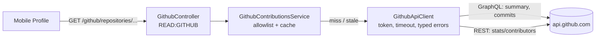

# GitHub contributions

The API reads GitHub repositories with its own read-only token and answers four views of them. The
repositories are either **pinned** in config or **discovered** from the token's account (its own
public repositories plus the public ones it contributed to). The mobile app shows them in a section of the Profile screen. The decision record is
[ADR 045](../adr/045-github-contributions-integration.md); every endpoint, field and error is in the
[API reference](./api-reference/github.md).



## 1. Turning it on

| Variable | Meaning |
| --- | --- |
| `GITHUB_TOKEN` | Turns the integration on (unset = off, an empty list). A **fine-grained personal access token** with *Contents: Read-only* and *Metadata: Read-only*, nothing else. It never leaves the API. |
| `GITHUB_REPOSITORIES` | Optional. Comma-separated `owner/repository`, at most 20, each once (case-insensitive): **pins** the list. Unset = **discover** it from the token's account (below). |
| `GITHUB_REQUEST_TIMEOUT_MS` | Budget of one GitHub request, 1–30000, default `5000`. |
| `GITHUB_CACHE_TTL_MS` | How long an answer is reused before GitHub is read again, default `300000` (5 min). |

```bash
# apps/api/.env — discover: your own repositories and the ones you contributed to
GITHUB_TOKEN=github_pat_...

# …or pin exactly these
GITHUB_REPOSITORIES=octo-org/hello-world,octo-org/website
```

Restart the API. The mobile Profile shows the section; without a token the list is empty and the
section is hidden.

**Discovery** (no `GITHUB_REPOSITORIES`) asks GitHub, as the token's account, for up to 50 of its
own **public, non-fork** repositories and up to 50 **public** repositories it contributed commits or
pull requests to (GitHub keeps roughly the last year of those), merges them — a repository it owns is
listed once, as owned — and orders them by last push. Private repositories are never listed: every
signed-in user of the app can see this list. The discovered list is cached like every other answer.
The API refuses to boot with repositories but no token, or with a malformed or duplicated entry
([configuration](./configuration/api.md#6-cross-field-rules)).

## 2. Endpoints and authorization

Every route is `GET`, read-only (so no audit entry), and needs `READ:GITHUB`. The `User`, `Manager`,
`Admin` and `SuperAdmin` system roles hold it.

| Endpoint | Answers | Ownership / tenant / RLS |
| --- | --- | --- |
| `/github/repositories` | `{ source, account, repositories }` — `source` is `configured` (pinned, in the configured order), `discovered` (`account` = the token's login; each repository `owned` or `contributed`, with its last push, most recent first) or `off` | None: the list is platform configuration, the same for every caller |
| `/github/repositories/:owner/:repository` | Stars, forks, watchers, open issues, commit count of the default branch, last push, up to 10 languages with their share | Same — and the repository must be in the allowlist (404 otherwise) |
| `/github/repositories/:owner/:repository/commits?cursor=&limit=` | One page (1–50, default 20) of the default branch's history, newest first: headline, author, time, **lines added / deleted**, files changed; `nextCursor` for the next page | Same |
| `/github/repositories/:owner/:repository/contributors` | `{ status: "ready", contributors }` — per contributor: commits, lines added, lines deleted, most commits first — or `{ status: "computing" }` | Same |

`READ:GITHUB` is a **GLOBAL** grant on the `User` role, the one exception to "every customer grant
is OWN-scoped": the repositories are shared configuration that no user owns, so OWN scope has
nothing to check. The role catalog's test names this exception explicitly.

**The list is the security boundary.** The requested `owner/repository` is matched against the
list (pinned, or discovered — itself read from GitHub, then cached) before anything else; a repository not listed is a 404 whether or not it
exists on GitHub, and GitHub is never called for it. Without that check the API's token would be a
proxy to every repository the token can see.

## 3. Failure behavior

| Situation | Behavior |
| --- | --- |
| GitHub answers within the budget | The answer is mapped to the contract, cached for `GITHUB_CACHE_TTL_MS`, and returned |
| A fresh answer is cached | Returned without calling GitHub |
| Several requests miss the same key at once | One GitHub request; the others wait for it (single flight) |
| GitHub times out / is unreachable / rate-limits the token | The last good answer is served if it is at most **one hour** past its cache lifetime (logged as a warning); otherwise **503** `SERVICE_UNAVAILABLE` |
| GitHub rejects the token, errors, or answers in an unexpected shape | Same fallback; otherwise **502** `EXTERNAL_SERVICE_ERROR` (the cause is logged, never sent) |
| GitHub no longer shows the repository to the token | **404** — never replaced by a stale answer |
| Contributor statistics not computed yet (GitHub's `202`) | `{ status: "computing" }`, not cached; the previous `ready` answer is served when there is one |

Decisions per [rules/12](../../rules/12-observability-and-operations.md#for-every-external-dependency-decide-explicitly):

- **Timeout**: `GITHUB_REQUEST_TIMEOUT_MS` on every request (`AbortSignal.timeout`).
- **Retry**: none on the server — the client retries 5xx queries with backoff, and GitHub's rate limit
  makes server-side retries counter-productive.
- **Circuit breaker**: none. The cache bounds GitHub traffic to one request per key per
  `GITHUB_CACHE_TTL_MS` per instance however many people open the screen, so a struggling GitHub is
  never hammered; the stale fallback is the degradation.
- **Cache location**: in memory per API instance (`BoundedTtlCache`, 500 answers per kind, oldest
  evicted). The data is public repository metadata and a lost cache costs one GitHub read; Redis
  would add a dependency for no correctness gain ([ADR 045](../adr/045-github-contributions-integration.md)).

## 4. Mobile Profile section

`apps/mobile/src/features/github/github-contributions-section.tsx`, under the profile editor:

- **Hidden** when the list is empty (integration off) or the account lacks `READ:GITHUB` (403).
- A **repository dropdown** (`SelectField`, a combobox) when the list has more than one
  repository: the field shows the chosen one; pressing it opens a sheet where each repository says
  "Your repository" / "Contributed to" and when it was last pushed, with a search box once there are
  more than 8. A discovered list is headed "Public repositories of @login".
- **Pull to refresh** on Profile reloads the section too (`refreshGithubContributions`: every GitHub
  query key is nested under the list's scope). The API may still answer from its own cache.
- **Summary**: description, tiles for commits / stars / forks / open issues, languages with their
  share, "Last push 2 hours ago".
- **Top contributors**: the five with most commits (then "Show all N contributors"), each with
  `+added −deleted`. While GitHub is computing, a short note, and the query asks again every 5 s.
- **Recent commits**: 10 per page with `+added −deleted` and files changed; "Show older commits"
  loads the next page by its cursor. Each page is its own query, so loaded pages stay cached.
- Tapping a commit or a contributor opens it on GitHub (`Linking.openURL`).

Each part loads, fails and retries on its own; a failure shows the API's message with "Try again".

## 5. Code map

| Layer | Where |
| --- | --- |
| Contract (zod, shared) | `packages/shared/src/schemas/domain/github/github-contributions.ts`, routes in `api-routes.ts`, leaves in `contracts/index.ts` |
| Permission | `GITHUB` resource (`schema.prisma` enum + migration `add_github_permission_resource`), `READ:GITHUB` in `permissions-registry.ts`, grants in `system-role-catalog.ts` |
| API | `apps/api/src/modules/github/` — controller, service (allowlist + caches), `GithubApiClient` (the only code that calls GitHub), wire schemas, GraphQL documents, mappers, errors |
| Config | `GithubConfig` in `apps/api/src/config/api-config.schema.ts` |
| Client | `apiRouter.github.*` in `packages/api-client/src/router.ts` |
| Mobile | `features/github/` (section, labels, refresh), `components/select-field.tsx`, `components/change-row.tsx`, `components/stat-tiles.tsx` |

## 6. Known limits and next steps

- **GitHub's own limits**: contributor statistics cover the top 100 contributors, and GitHub reports
  0 added / deleted lines for repositories with 10,000+ commits; `changedFiles` is `null` for very
  large commits.
- **Commits by people without a GitHub account** still appear in the history (git name shown) but
  not in contributor totals, which GitHub keys by account.
- **Discovery covers public repositories only**, at most 50 owned and 50 contributed to, and only
  *recent* contributions (GitHub's `repositoriesContributedTo`). Pin older or private ones with
  `GITHUB_REPOSITORIES` (pinning replaces discovery).
- **An invalid `cursor`** (one GitHub did not issue) is answered 502, because GitHub reports it as a
  generic GraphQL error.
- **Per-user GitHub accounts** (each person links their own GitHub through OAuth, for a project
  management system) need a token table with encrypted tokens and an OAuth flow — a separate
  feature built on this client and contract.
- **Web / portfolio**: the endpoints are client-agnostic; a web page only needs the router leaves.
- **API reference samples**: only the list can be captured (the capture API has no GitHub token).
