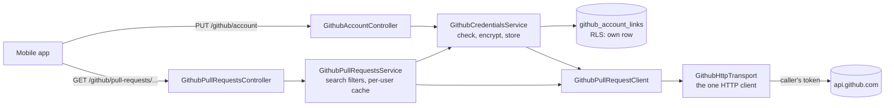

# GitHub pull requests

Admins link **their own** fine-grained GitHub token; every pull-request read is made with it, so
GitHub decides what each admin sees — public and private repositories alike. Nothing about a pull
request is stored: the API reads GitHub, keeps a short per-user cache, and answers the shared
contract. The decision record is [ADR 052](../adr/052-github-pull-requests.md); every endpoint,
field and error is in the [API reference](./api-reference/github-pull-requests.md). The read-only
contributions on the Profile are a separate integration with the server's own token
([GitHub contributions](./github-contributions.md)).

## 1. Turning it on

| Variable                            | Meaning                                                                                                                                                                                                                                                                                                                       |
| ----------------------------------- | ----------------------------------------------------------------------------------------------------------------------------------------------------------------------------------------------------------------------------------------------------------------------------------------------------------------------------- |
| `GITHUB_CREDENTIAL_ENCRYPTION_KEYS` | Turns pull requests on. A versioned key ring, same format as `MFA_ENCRYPTION_KEYS` but its **own** keys: `{"1":"<openssl rand -base64 32>"}`. `pnpm secrets:generate` adds it (and a new version on every run). Unset: `GET /github/account` answers `{ "status": "off" }`, every other route 503 `GITHUB_PULL_REQUESTS_OFF`. |
| `GITHUB_REQUEST_TIMEOUT_MS`         | Shared with the contributions integration: the budget of one GitHub request.                                                                                                                                                                                                                                                  |
| `GITHUB_WEBHOOK_URL`                | Turns **live updates** on (with the secret). Where GitHub delivers webhooks: this API's public **https** address + `/api/v1/github/webhook`. GitHub must reach it from the internet, so local development has no live updates unless the API is public.                                                         |
| `GITHUB_WEBHOOK_SECRET`             | Signs every delivery (`openssl rand -hex 32`, at least 32 characters). Set both or neither; both need `GITHUB_CREDENTIAL_ENCRYPTION_KEYS`. Unset: live updates answer `{ "status": "off" }` and the apps read on open and on pull-to-refresh.                                                                            |

Then sync the permission catalog so the Admin role holds the new grants (deployments run this as
part of every release): `pnpm --filter @workspace/api db:sync-reference-data`.

## 2. Who may use it

| Permission                   | Grants                                     | Held by           |
| ---------------------------- | ------------------------------------------ | ----------------- |
| `READ:GITHUB_PULL_REQUEST`   | See your link; list and read pull requests | Admin, SuperAdmin |
| `UPDATE:GITHUB_PULL_REQUEST` | Link or unlink your token; comment, review, react, attach pictures; turn live updates on or off | Admin, SuperAdmin |

Every route is also admin-panel only (`@AdminAccessOnly`). Within that, **GitHub** is the
authority: each request uses the caller's own token, so an admin can never see a repository their
token cannot.

## 3. Linking a token

Create a **fine-grained personal access token** on GitHub (Settings → Developer settings → Personal
access tokens → Fine-grained), for the repositories (or the account) you want, with:

| Permission    | Access         | For                                                         |
| ------------- | -------------- | ----------------------------------------------------------- |
| Pull requests | Read and write | Reading, commenting, reviewing and reactions                |
| Contents      | Read and write | Files and diffs; merging; deleting a merged branch; attaching pictures (read-only is enough without them) |
| Metadata      | Read-only      | Required by GitHub                                          |
| Webhooks      | Read and write | Live updates; optional                                      |

`PUT /github/account` with `{ "personalAccessToken": "github_pat_…" }`:

1. GitHub is asked who the token belongs to (`GET /user`) and when it expires (the
   `github-authentication-token-expiration` header). A token GitHub refuses is a 400
   `GITHUB_TOKEN_INVALID`; nothing is stored.
2. The token is encrypted with AES-256-GCM under the highest key version, with the owner's user id
   as additional authenticated data — a ciphertext copied onto another user's row does not decrypt.
3. It is stored in `GithubAccountLink` (one row per user; linking again replaces the token in
   place). The token is never returned, never logged, and redacted from the HTTP audit log (the
   field name ends in `token`); the row-change audit (ADR 051) records `tokenCiphertext` as
   `[REDACTED]`.

`DELETE /github/account` soft-deletes the row **and wipes the token from it** — nothing that opens
anything is kept.

When GitHub later refuses the stored token (revoked or expired), the link is marked `REJECTED`: the
status answers `health: "rejected"` and every pull-request route 409 `GITHUB_TOKEN_REJECTED` until a
new token is linked. A token no configured key version opens (its version was removed from the ring)
is treated the same way.

**Key rotation:** add a version (`pnpm secrets:generate`); new links use it, existing tokens keep
decrypting with their own. Remove an old version only once every admin has re-linked.

## 4. Reading

| Route                                                  | Answers                                                                                                                                                                                                                                                                |
| ------------------------------------------------------ | ---------------------------------------------------------------------------------------------------------------------------------------------------------------------------------------------------------------------------------------------------------------------- |
| `GET /github/pull-requests?filter=&state=&cursor=`     | 25 pull requests a page, most recently updated first                                                                                                                                                                                                                   |
| `GET /github/pull-requests/:owner/:repository/:number` | The pull request and the first 50 conversation entries                                                                                                                                                                                                                 |
| `…/timeline?cursor=`                                   | The next 50 conversation entries                                                                                                                                                                                                                                       |
| `…/commits?cursor=`                                    | Commits, 50 a page                                                                                                                                                                                                                                                     |
| `…/files?page=`                                        | Changed files with diffs, 100 a page (same limits as a commit's) and the head commit they belong to                                                                                                                                                                    |
| `…/review-threads`                                     | Line-comment threads (100 threads × 50 comments)                                                                                                                                                                                                                       |
| `…/status`                                             | GitHub's merge box, read live: the head commit's checks (`summary` with counts per bucket, `none`, or `unavailable` when GitHub won't show them to your token) and whether the branch merges cleanly (`mergeable`, `conflicting`, `unknown` while GitHub works it out) |
| `…/commits/:sha`                                       | One of its commits with every changed file and its diff, read with your token                                                                                                                                                                                          |
| `GET /github/content-edits/:nodeId`                    | Every saved version of a comment, review or description                                                                                                                                                                                                                |

**The list's filters** are a closed set, turned into a GitHub search by the API — no
client-supplied search text ever reaches GitHub:

| `filter`          | GitHub search                                               |
| ----------------- | ----------------------------------------------------------- |
| `yours` (default) | `user:<your login>` — repositories your GitHub account owns |
| `created`         | `author:@me`                                                |
| `reviewRequested` | `review-requested:@me`                                      |
| `assigned`        | `assignee:@me`                                              |
| `mentioned`       | `mentions:@me`                                              |

Every search adds `is:pr archived:false sort:updated-desc` and `is:open` / `is:closed`.

**The conversation** shows comments, reviews (with their first 20 line comments), pushed commits,
and these events: closed, reopened, merged, ready for review, back to draft, review requested,
labeled, unlabeled, force-pushed, renamed.

**Pictures in the conversation.** Every comment, review and line comment carries `images`, and the
pull request carries `bodyImages`: each picture its markdown names (`source`, as written) with the
address to load it from (`url`). A picture uploaded to GitHub
(`https://github.com/user-attachments/assets/<id>`) is not served at that address to an app — GitHub
hands out a signed `private-user-images.githubusercontent.com/…-<id>.png?jwt=…` link that works for
about **five minutes**, and sends other pictures through its image proxy (`camo.githubusercontent.com`,
the original kept in `data-canonical-src`). The API asks GitHub for its rendering of each body
(`bodyHTML`, read for its `` tags only — `github-body-images.ts`) and pairs every link with the
address the markdown names; a client loads each picture with `githubImageUrlFor(source, images)`
(`@workspace/shared`), which matches by address or by upload id. Emoji are skipped. A comment the app
just posted comes back with `images: []` (REST does not render it); the conversation reload that
follows brings them. The 30-second cache sits well inside the links' five minutes; a picture that
still fails to load says so and offers its address in the browser, where GitHub's own sign-in applies.

**Caching:** each answer is reused for 30 seconds **per user** (a user's token decides what they
see, so nothing is shared), with the same single-flight and stale-on-failure rules as the
contributions cache. Linking or unlinking drops the user's answers.

## 5. Writing (synced to GitHub)

| Route                                                         | Does                                                                                                 |
| ------------------------------------------------------------- | ---------------------------------------------------------------------------------------------------- |
| `POST …/:owner/:repository/:number/comments` `{ body }`       | Comments on the conversation                                                                         |
| `POST …/:owner/:repository/:number/reviews` `{ event, body }` | Submits a review: `comment`, `approve` or `requestChanges` (a summary is required except to approve) |
| `PUT …/:owner/:repository/:number/reactions` `{ subject, content, reacted }` | Sets your emoji reaction on or off (below)                                                           |
| `POST …/:owner/:repository/:number/merge` `{ method, expectedHeadSha, commitTitle, commitMessage, deleteBranch }` | Merges it, then optionally deletes its branch (below)                              |

Both need `UPDATE:GITHUB_PULL_REQUEST` and an **`Idempotency-Key`** header (400
`IDEMPOTENCY_KEY_REQUIRED` without one). A retry with the same key gets the first answer back from the
platform ledger, so GitHub never gets the comment twice; a key reused for a different body is refused.
The mobile app keeps one key per draft (`apps/mobile/src/lib/idempotency-keys.ts`): the same text
sent again after a failure reuses it, edited text gets a new one, a success spends it. The client
sends it through `useIdempotentMutation()` (`@workspace/api-client/react`).

The API writes through GitHub's REST endpoints as the caller's linked account —
`POST /repos/:owner/:repo/issues/:number/comments` and `POST /repos/:owner/:repo/pulls/:number/reviews`
— because GitHub documents them as taking a fine-grained token with _Pull requests: Read and write_
(in testing, its GraphQL `addComment` refused such a token with "Resource not accessible by personal
access token"). GitHub's answer is mapped straight to the contract's comment and review
shapes, with no second request after a successful write. Refusals come back as **409
`GITHUB_WRITE_REJECTED`**:

- **403** (not a rate limit): the token may not write to that repository. The message says so and names
  the permission to add: _Pull requests: Read and write_ for that repository, on GitHub's token page.
- **422**: GitHub's own rules, such as approving your own pull request or a locked conversation. The
  message is GitHub's reason.

A successful write drops every cached view of that pull request.

**Known limit:** if GitHub saves a write but its answer never reaches the API (a timeout), the API
answers 503 and keeps no result for the key, so a retry can post a second time. With live updates on
(§5a), the comment that did arrive shows in the conversation at once, so the person sees it before
retrying.

### Merging

`GET …/status` answers `merge` beside the checks and mergeability: the head commit (`headSha`), GitHub's
verdict on merging now (`state`: `clean`, `unstable`, `hasHooks`, `behind`, `blocked`, `dirty`, `draft`,
`unknown`), the methods the repository allows (`merge`, `squash`, `rebase`, in that order), the one GitHub
suggests to you (`defaultMethod`), the head branch, whether it is this repository's (`canDeleteHeadBranch`
— a fork's branch is never deleted from here) and whether the repository deletes merged branches itself.

`POST …/merge` (Idempotency-Key required, `UPDATE:GITHUB_PULL_REQUEST`) merges through REST
(`PUT /repos/…/pulls/:number/merge`, _Contents: Read and write_) **pinned to `expectedHeadSha`**: if the
branch moved on since it was read, GitHub refuses (409 → `GITHUB_WRITE_REJECTED`, "Head branch was
modified…"), so nothing unseen is merged. An empty `commitTitle` / `commitMessage` leaves GitHub's own; a
rebase takes neither. GitHub's own refusals — not mergeable (405), required reviews or checks, branch
protection — answer 409 `GITHUB_WRITE_REJECTED` with GitHub's reason. With `deleteBranch`, the branch is
deleted afterwards (`DELETE /repos/…/git/refs/heads/<branch>`; one the repository already deleted counts as
deleted). Deleting never undoes the merge: the answer's `branch.outcome` is `deleted`, `kept` (not asked,
or a fork's branch) or `failed` with GitHub's reason (a protected branch). Every cached view is dropped.

### Reactions

GitHub's eight reactions (👍 👎 😄 🎉 😕 ❤️ 🚀 👀, `thumbsUp` … `eyes`). Every comment carries
`reactions` — the ones someone chose, in GitHub's order, each with its `count` and whether you chose it
(`viewerHasReacted`) — and `reactionSubject`, what to send to change yours; the pull request carries
`reactions` for its description (subject `{ type: "pullRequest" }`).

`PUT …/reactions` sets yours **on or off**, on GitHub, as your account, through REST (which takes a
fine-grained token with _Pull requests: Read and write_): the pull request is `/issues/:number`, a
conversation comment `/issues/comments/:id`, a line comment `/pulls/comments/:id` (`commentId` is
GitHub's `fullDatabaseId`, a string — the ids no longer fit 32 bits). On adds the reaction (GitHub
answers an existing one unchanged); off finds your own reaction of that kind (`GET …/reactions?content=`,
page by page) and deletes it, and does nothing when you have none. Setting a reaction to what it already
is changes nothing, so it needs **no `Idempotency-Key`**. A **review's summary** has no REST reactions,
so its `reactionSubject` is `null`: its reactions are shown, not changed. Same refusals (409
`GITHUB_WRITE_REJECTED`) and cache drop as the other writes.

### Attaching pictures

GitHub has **no API for its own uploads** (`github.com/user-attachments/…` is made only by its web
editor, with a browser session — a token cannot use it), so a picture attached from the app is
**committed to the pull request's repository** and the comment links it there:

1. The app uploads it as a **`GITHUB_COMMENT_IMAGE`** file — the normal storage flow (ticket →
   direct upload → `complete` → scan → READY; [storage overview](./storage/overview.md)). The file is
   **private**: only a staging copy. The ticket needs `UPDATE:GITHUB_PULL_REQUEST` and `userId` = the
   caller (anyone else gets 403). JPEG, PNG or WebP, at most 10 MB (GitHub's own limit).
2. `POST …/:number/pictures` `{ fileId }` (Idempotency-Key required) answers **where it will be** —
   `{ url, path }`, `path` = `pull-requests/<number>/<fileId>.<ext>` on the branch
   **`github-comment-assets`**, `url` = `https://github.com/<owner>/<repo>/raw/github-comment-assets/<path>` —
   and **commits nothing**. Only your own READY upload qualifies (404 otherwise). The app adds a markdown
   image of `url` to the draft.
3. **Posting** a comment or review (`POST …/comments`, `…/reviews`) first commits, with your token, every
   picture its body links on that branch of this repository that is still your upload — then the upload is
   deleted — and only then posts the body. So a picture **taken out of the draft is never committed**.
   The branch has its own history: the first picture of a repository starts it from a commit with **no
   parent** (Git data API: blob → tree → commit → ref), so none of the code is copied into it, and it is
   never merged; later pictures are added on top (contents API). Two posts committing the same new picture
   at once: GitHub refuses the second, which then finds the file there and goes on. A linked picture
   already committed is left as it is. Your token needs **Contents: Read and write** there; without it
   the answer is 409 `GITHUB_WRITE_REJECTED`, naming that permission, and nothing is posted.
4. **Unused pictures:** an upload no posted comment linked is a staging copy past its time after **a day**
   (`stagingRetentionMs` of `GITHUB_COMMENT_IMAGE`): the hourly storage sweep deletes it. The app keeps no
   drafts, so a comment is written in one sitting. A comment that still links such a picture — gone, never
   committed — is refused with 409 `GITHUB_PICTURE_UNAVAILABLE` ("attach it again"), so it never shows a
   broken picture.

**Who can see it:** exactly who can read the repository. GitHub leaves `github.com/<owner>/<repo>/raw/…`
images as they are (no signing, no image proxy), so on github.com each reader's browser loads it with
their own sign-in — a private repository's picture stays private, like GitHub's own uploads. It works the
same in development and production; nothing depends on this app's storage being public.

**In the app:** the app has no GitHub sign-in, and two kinds of picture open only for a signed-in reader:
a **repository file** (ours, or any `github.com/…/raw|blob/…` or `raw.githubusercontent.com/…` image), and
an **upload to a private repository** (GitHub's signed `private-user-images…` link to it expires in about
five minutes). For both, the API lists an address of its own in `images[].url` (`GithubPictureAddresses`):

| Picture | `images[].url` | Served by reading |
| --- | --- | --- |
| Repository file | `GET /api/v1/github/pictures/file?owner&repository&ref&path` | the file, with the caller's token (contents API, raw) |
| Upload to a private repository | `GET /api/v1/github/pictures/uploads/:attachmentId?node=<node id>` | the body of `node` (the pull request, comment, review or line comment showing it), with the caller's token — GitHub signs a fresh link in it — then the picture through that link, **without** the token |

The address names **no reader and never expires**, so an answer cached by the API (fresh 30 s, stale
fallback while GitHub is down) or held by the app never carries a dead link. The app asks for it from the
API it talks to, **signed in** like any request (`Authorization: Bearer …`; a browser sends its session
cookie); the route needs `READ:GITHUB_PULL_REQUEST` and the admin panel, and reads with **the caller's
own token**, so GitHub still decides access. Only JPEG, PNG, WebP and AVIF (checked by their bytes, at
most 25 MB) are answered, with `nosniff`, a sandboxing CSP and `Cache-Control: private, max-age=3600`.
Anything else, or a picture the caller's token cannot see, is a 404. In the app, a picture that fails on
an expired access token renews the session once and is asked for again (`api-image-authorization.tsx`);
only addresses the API itself listed for that body carry the token, never one a comment merely names.

**Pictures attached before this (2026-10-15, development only)** link this app's local storage
(`…/files/<id>/local-public`), which GitHub cannot reach; edit those comments on GitHub to replace them.

## 5a. Live updates (webhooks)

A repository's pull requests can update by themselves: GitHub tells the API about every change
(a webhook), and the API tells the apps (Server-Sent Events). Off unless `GITHUB_WEBHOOK_URL` and
`GITHUB_WEBHOOK_SECRET` are set (§1).

| Route                                           | Does                                                                                                         |
| ----------------------------------------------- | ------------------------------------------------------------------------------------------------------------ |
| `GET /github/live-updates/:owner/:repository`    | `{ status: "off" }` (no webhook settings), `"disabled"`, or `"enabled"` with `enabledAt`                     |
| `PUT /github/live-updates/:owner/:repository`    | Turns them on: registers a webhook on the repository **with your token** (needs _Webhooks: Read and write_) |
| `DELETE /github/live-updates/:owner/:repository` | Turns them off: deletes the webhook on GitHub with your token                                                 |
| `GET /github/live-updates/:owner/:repository/events` | The repository's changes (SSE), only if **your** token can see the repository (404 otherwise)          |
| `POST /github/webhook`                           | GitHub's deliveries — public, verified by signature                                                          |

**Turning on and off.** One webhook per repository (`GithubWebhookSubscription`, one row per
repository, shared by every admin, soft-deleted when turned off and restored when turned on again).
It is a JSON web hook for `pull_request`, `pull_request_review`, `pull_request_review_comment`,
`pull_request_review_thread` and `issue_comment`, signed with the secret. A hook already delivering to
this address (after a database reset, say) is adopted and refreshed instead of duplicated; GitHub
refuses a second hook with the same address, and the row is claimed in one statement, so two admins
turning a repository on at once end up on one hook. PUT and DELETE are idempotent by construction (no
`Idempotency-Key`). 503 `GITHUB_LIVE_UPDATES_OFF` when the server has no webhook settings; a token
without the permission gets 409 `GITHUB_WRITE_REJECTED` naming _Webhooks_.

**Receiving.** `X-Hub-Signature-256` (HMAC-SHA256 of the **exact raw body** with the secret) is checked
in constant time before anything is parsed — 403 otherwise. `ping` is acknowledged; other events
answer `ignored`; an `issue_comment` on an issue (not a pull request) is ignored. A delivery is recorded
once by its `X-GitHub-Delivery` id (`GithubWebhookDelivery`; a redelivery answers `duplicate`), and
in the same transaction announced with `pg_notify('github_pull_requests', …)` — delivered at commit,
so never ahead of the record. Only the owner, repository and pull-request number are kept; nothing of
the content. Deliveries are pruned after **7 days** (hourly job; GitHub lets a person redeliver for 3).

**Fan-out.** Every API instance keeps one Postgres `LISTEN` on `github_pull_requests` while live updates
are configured (`GithubPullRequestChangesHub`; reconnects with backoff, then tells every stream to
`resync`). On a change it drops its cached reads of that pull request for every user (of the whole
repository when GitHub named no pull request) and passes the change to its open streams. No Redis is
needed: the database reaches every instance.

**Trying it on a laptop.** GitHub can only reach a public https address. `pnpm dev:tunnel`
(the `tunnel` command of `apps/api/scripts/dev.ts`) starts a detached Cloudflare quick tunnel to `localhost:8080`
and wires it: the Resend webhook is re-pointed (as before), and `github:webhook-tunnel`
(its `github-webhook` command) writes `GITHUB_WEBHOOK_URL=<tunnel>/api/v1/github/webhook`
to `apps/api/.env` (generating `GITHUB_WEBHOOK_SECRET` if it is missing) and re-points every repository
already turned on to the new address on GitHub, with the token of the admin who turned it on (a hook
deleted on GitHub meanwhile is turned off here). Then:

1. Restart the API (`pnpm dev`) so it reads the new address.
2. In the app, open a pull request and tap **Turn on** (your token needs _Webhooks: Read and write_).
   GitHub sends a `ping`: Settings → Webhooks → Recent Deliveries on the repository shows it.
3. Comment, react or push on github.com — the pull request open in the app reloads by itself.

Every quick tunnel gets a new address, so run `pnpm dev:tunnel` again after a restart; it re-points the
hooks. Stop it with `pkill -f 'cloudflared tunnel --url'`. The quick tunnel runs with an empty config of
its own: a named tunnel's `~/.cloudflared/config.yml` would otherwise apply its ingress rules to it and
answer every request 404. Development only (refused with `NODE_ENV=production`); a deployed API sets
`GITHUB_WEBHOOK_URL` to its own domain.

**Streaming.** An app listens to **one repository at a time**, and the API first asks GitHub with the
caller's own token whether they can see it (a guard, so a refusal is a plain 404 before any stream
opens) — no one learns of activity in a repository GitHub would not show them. A frame is
`{ owner, repository, number }`, `event: resync` when changes may have been missed, `event: ping` every
25 s. The app reloads what it shows with its own reads.

## 6. The mobile app

The drawer shows a **GitHub** section (Pull requests, GitHub token) only when `GET /github/account`
answers something other than `off` — a 403 (not an admin) or a server with pull requests off hides
it. The app hides only what the API would refuse anyway.

| Screen         | Route                                              | What it shows                                                                                                                                                                                                                                                                                                                                                                                                                                                                                                                                                                                                                                                                                                                                                                                                                                                                                                                               |
| -------------- | -------------------------------------------------- | ------------------------------------------------------------------------------------------------------------------------------------------------------------------------------------------------------------------------------------------------------------------------------------------------------------------------------------------------------------------------------------------------------------------------------------------------------------------------------------------------------------------------------------------------------------------------------------------------------------------------------------------------------------------------------------------------------------------------------------------------------------------------------------------------------------------------------------------------------------------------------------------------------------------------------------------- |
| Pull requests  | `/profile/pull-requests`                           | A state chip (open / closed) and a filter chip (the five filters above), then the pull requests; "Load more" adds the next page under the first                                                                                                                                                                                                                                                                                                                                                                                                                                                                                                                                                                                                                                                                                                                                                                                             |
| A pull request | `/profile/pull-request?owner=&repository=&number=` | One scroll, as GitHub lays it out. The header holds `owner/repo #42`, the title, the state pill, the review decision and a compact **View on GitHub** pill (the primary colour, like _Comment_). Then "octocat wants to merge 3 commits into main from feature", the labels and requested reviewers, and the Commits and Files changed rows (`+added` in green, `−deleted` in red). Then the **conversation on one line down the left**: the description, comments (avatar on the line, a tinted header with "Author" and "edited"), reviews (their verdict on the line in its colour), pushed commits (open in the app) and events. While it is open, **GitHub's merge box** follows: review, checks ("All checks have passed", with the counts) and conflicts ("No conflicts with base branch"), each a row tinted like the app's toasts, in words with its own glyph. Last comes the comment box, with _Review changes_ beside _Comment_ |
| Files changed  | `/profile/pull-request-files?…`                    | Each file with its diff; line-comment threads sit under the line they are on (`right` threads on the new file's line, `left` on the old one's); outdated threads above the diff                                                                                                                                                                                                                                                                                                                                                                                                                                                                                                                                                                                                                                                                                                                                                             |
| Commits        | `/profile/pull-request-commits?…`                  | The commits, oldest first; a commit opens its own screen                                                                                                                                                                                                                                                                                                                                                                                                                                                                                                                                                                                                                                                                                                                                                                                                                                                                                    |
| A commit       | `/profile/pull-request-commit?…&sha=`              | The Profile's commit page (message, author, SHA, parents, every file with its diff), read with your own token through `GET …/:number/commits/:sha` — so private repositories work too                                                                                                                                                                                                                                                                                                                                                                                                                                                                                                                                                                                                                                                                                                                                                       |
| GitHub token   | `/profile/github-account`                          | The linked account, its health and expiry, the permissions a token needs, a button to GitHub's token page, the token field (checked with the shared schema before it is sent) and "Remove token" behind a confirmation                                                                                                                                                                                                                                                                                                                                                                                                                                                                                                                                                                                                                                                                                                                      |

**Pictures:** a comment's pictures — markdown images and GitHub's `` HTML, which is what
GitHub writes for a pasted screenshot — are drawn at the text's width in their own proportions
(`` when given), never wider than the picture itself, from the links in §4. Tapping
one opens it full screen; a linked picture (a badge) opens its link instead. HTML that only lays
pictures out (`
`, `<a>`, `<picture>`) is dropped around them; other HTML stays as
written. **Add a picture** (the image button on the row above _Review changes_ / _Comment_, and above _Submit review_) opens the
photo library, holds the picture's place with an "Uploading…" line, uploads it and has it committed to the
repository (§5, _Attaching pictures_) and swaps the line for its markdown; _Comment_ waits until the upload is done. A refused
or failed upload takes the line out again and says why. The library is the only source (no camera);
`app.config.ts` sets the iOS photo-library message and blocks the camera and microphone permissions.

**Reactions:** under the description and every comment, a pill per reaction someone chose ("👍 2",
outlined in the primary colour when one of them is you) and a smiley button that opens GitHub's eight
in a sheet. Tapping a pill or an emoji sets yours on or off at once; if GitHub refuses, it is put back
and the reason shows as a toast; then the pull request reloads. A review's summary shows its reactions
without the button. The screens name the pull request through `PullRequestReactionsProvider`
(`comment-reactions.tsx`); the pills are `components/reaction-bar.tsx`.

**Live updates:** under the header, while the server has them, a row says "Live" with a breathing
dot (and "Turn off"), "Reconnecting…", or "Live updates are off" (and "Turn on"). While they are on,
the screen is showing and the app is in the foreground, it holds the repository's stream
(`lib/server-events.ts` over `expo/fetch`, which streams a body; bearer token, a 401 renews the session
once, reconnect 1 s → 30 s) and a change to this pull request — or a `resync` — reloads all its views
(`use-pull-request-live-updates.ts`, `live-updates-row.tsx`).

**Merging:** under the merge box's rows, **Merge pull request** opens a sheet with the repository's
methods (GitHub's suggestion selected), the commit title GitHub would write (`Merge pull request #42 from
owner/branch`, or `<title> (#42)` for a squash; editable; none for a rebase), an optional message, and
**Delete branch … after merge** (checked; not offered for a fork's branch). _Confirm …_ merges the head the
box read, with an Idempotency-Key; the toast says "Pull request merged and branch … deleted.", a branch
GitHub kept is reported with its reason, and the pull request reloads as merged. Over conflicts, as a
draft, or with no allowed method, the box says why instead of offering the button. **Approving and
requesting changes** are in _Review changes_ — offered only on someone else's pull request, as GitHub
allows.

**Review changes** opens a sheet with a summary and GitHub's three verdicts. The author of the pull
request is offered only _Comment_, as GitHub allows. Blank text is caught by the shared schemas before
anything is sent; GitHub's refusals show its reason.

"Edited" on a comment or the description opens its **edit history** in a sheet (`GET
/github/content-edits/:nodeId`, read only while the sheet is open). A read that fails with
`GITHUB_ACCOUNT_NOT_LINKED` or `GITHUB_TOKEN_REJECTED` offers "Link a token" instead of a retry.

**Refreshing:** every pull-request query key starts with `GITHUB_PULL_REQUESTS_QUERY_ROOT`, and
every view of one pull request shares `githubPullRequestScopeKey(…)` (both exported by
`@workspace/api-client`). Linking or removing the token reloads `githubPullRequestsRootKey()`; pull-to-refresh on a
pull request's screens reloads its scope. Route params are parsed with the shared
`GithubPullRequestParamsSchema` — a link that names no pull request says so instead of asking the API.

## 7. Failures

| Status                          | When                                                                                                   |
| ------------------------------- | ------------------------------------------------------------------------------------------------------ |
| 409 `GITHUB_ACCOUNT_NOT_LINKED` | No token linked yet                                                                                    |
| 409 `GITHUB_TOKEN_REJECTED`     | GitHub stopped accepting the token                                                                     |
| 404                             | GitHub has no such pull request or comment, or your token cannot see it (GitHub answers both the same) |
| 503                             | GitHub slow, unreachable or rate-limiting your token, and no earlier answer can stand in               |
| 502                             | GitHub answered with an error or an unexpected shape                                                   |
| 503 `GITHUB_PULL_REQUESTS_OFF`  | The server has no `GITHUB_CREDENTIAL_ENCRYPTION_KEYS`                                                  |
| 409 `GITHUB_WRITE_REJECTED`     | GitHub refused a comment or review; the message is GitHub's reason                                     |
| 400 `IDEMPOTENCY_KEY_REQUIRED`  | A comment or review sent without an `Idempotency-Key`                                                  |
| 503 `GITHUB_LIVE_UPDATES_OFF`   | Turning live updates on, or a webhook delivery, on a server without `GITHUB_WEBHOOK_URL`/`_SECRET`     |
| 403 `GITHUB_WEBHOOK_SIGNATURE_INVALID` | A webhook delivery whose signature does not match                                               |

## 8. Code map

| Piece                                              | File                                                                                                                          |
| -------------------------------------------------- | ----------------------------------------------------------------------------------------------------------------------------- |
| Contract (shared with the apps)                    | `packages/shared/src/schemas/domain/github/github-pull-requests.ts`                                                           |
| The one HTTP client for GitHub (both integrations) | `apps/api/src/contexts/integrations-github/infrastructure/github-api/github-http.transport.ts`                                                                        |
| Pull-request reads and writes                      | `apps/api/src/contexts/integrations-github/infrastructure/github-api/github-pull-request.client.ts`, `…queries.ts`, `…wire-schemas.ts`, `…mappers.ts`   |
| Link, encryption, storage                          | `github-credentials.service.ts`, `github-credential.cipher.ts`, `github-account-link.repository.ts`                           |
| Per-user cache                                     | `github-pull-request.cache.ts`                                                                                                |
| Routes                                             | `github-account.controller.ts`, `github-pull-requests.controller.ts`, `github-content-edits.controller.ts`                    |
| Mobile screens                                     | `apps/mobile/src/features/github-pull-requests/` (routes in `apps/mobile/src/app/(app)/profile/`)                             |
| Live updates (API)                                 | `apps/api/src/contexts/integrations-github/` (live-update commands in `application/commands/*-live-updates`, receiver in `presentation`, repository in `infrastructure/persistence`)                            |
| Live updates (mobile)                              | `apps/mobile/src/lib/server-events.ts`, `…/use-pull-request-live-updates.ts`, `…/live-updates-row.tsx`                          |
| Pictures: links read from GitHub                   | `apps/api/src/contexts/integrations-github/infrastructure/github-api/github-body-images.ts`; `packages/shared/…/github/github-body-images.ts`             |
| Pictures: drawing and attaching (mobile)           | `components/markdown-picture.tsx`, `components/image-viewer.tsx`, `lib/file-upload.ts`, `…/use-comment-image-attach.ts`         |
| Seed                                               | `apps/api/prisma/seed/github-account-links.ts` — an expired (rejected) link for the Admin, an unlinked one for the SuperAdmin; a developer's own (non-demo) link is never replaced. `github-webhooks.ts` — one repository live, one turned off, two deliveries |
