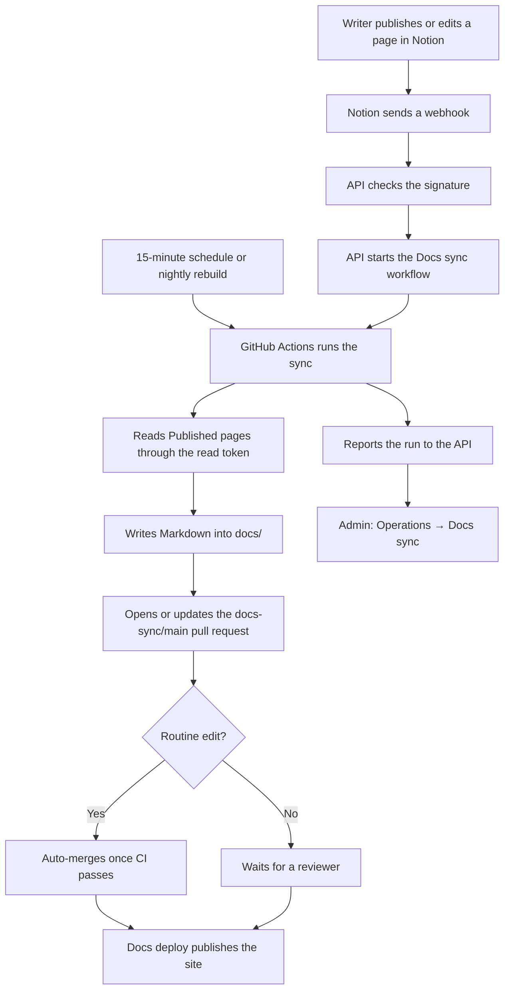
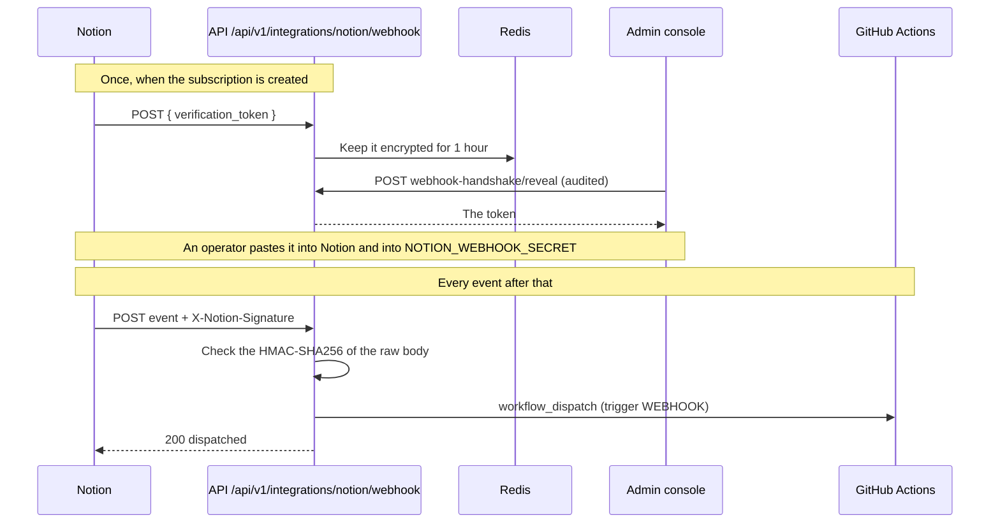

# Notion integration

Writers write and publish docs in Notion. A sync reads the published pages, turns them into Markdown, and opens a pull
request. Once it merges, the docs site shows the new version. The design and its reasons are in
[ADR 084](../adr/084-docs-sync-sources.md), and the original plan is in
[the Notion docs plan](../architecture/notion-docs-plan.md). The short, step-by-step setup checklist is
[the docs publishing runbook](operations/docs-publishing.md). This page explains how the integration works and how to
get every credential it needs.

## In one paragraph

Notion is the **source**, and the repository is the **record**. Nothing on the docs site comes straight from Notion: every
page reaches it as a Markdown file in `docs/`, through a pull request that CI checks like any other change. Notion's
webhook only makes a sync start sooner. A 15-minute schedule and a nightly full rebuild guarantee the site catches up even
if every webhook is lost.

## The parts

| Part | Where | What it does |
|---|---|---|
| Notion workspace | Notion | Four databases: **Docs Drafts**, **Docs Published**, **Blog Drafts** and **Blog Published**. Only the Published ones are ever read |
| `DocsSource` port | `packages/docs-sync/src/source.ts` | The seam: list the published documents, read one, fetch a file. It is the only thing a writing tool implements |
| Notion source | `packages/docs-sync/src/sources/notion/` | Notion's API client, block-to-Markdown converter, properties and folder tree |
| Sync engine | `packages/docs-sync/src/run-sync.ts` | Decides what changed, converts, validates, stages and writes. It knows nothing about Notion |
| Content rules | `packages/docs-content/` | The neutral document, front matter, the manifest, slugs, redirects and validation, shared by the sync and the site |
| One-time import | `packages/docs-sync/src/sources/notion/import/` | Creates the databases, lays out the Notion page, and copies the repository's existing pages into Notion |
| Sync workflow | `.github/workflows/docs-sync.yml` | Runs the sync in GitHub Actions, opens or updates the `docs-sync/main` pull request, and auto-merges routine edits |
| Docs guard | `packages/tooling/src/docs-guard/` | Refuses hand edits to generated pages, and decides whether a sync pull request may merge by itself |
| API context | `apps/api/src/contexts/docs-publishing/` | Receives Notion's webhook, starts the workflow, records sync runs, and serves the admin console |
| Admin console | `apps/admin/contexts/docs-publishing/` | **Operations → Docs sync**: setup status, runs, held-back pages, **Sync now** and **Show token** |
| Docs site | `apps/docs/` | Renders `docs/`, shows the **Edit in Notion** link, and redirects addresses that moved |

## How a change travels



### The webhook in detail



| Rule | Why |
|---|---|
| Every event must carry a valid `X-Notion-Signature: sha256=<hex>`: an HMAC-SHA256 of the raw body, keyed with the verification token | A forged request is refused with 403 before anything is parsed |
| The handshake is accepted without a signature check, but only while `NOTION_WEBHOOK_SECRET` is unset | Notion signs the handshake with the token it is delivering, which the server cannot know yet. Notion's documentation says the handshake is unsigned, but the live service signs it (seen 2026-11-11) |
| The token is never logged. It is kept encrypted in Redis for an hour, and shown only through an audited POST that needs the `READ DOCS_SYNC` permission | It is a secret |
| Only `page.*`, `data_source.*` and `database.*` events start a sync. `page.locked`, `page.unlocked` and comments are ignored | Only those can change what readers see |
| The webhook passes nothing from the request on to GitHub | A forged body could at worst start one extra sync |
| Duplicate deliveries are recognised and answered `duplicate` | Notion retries. The shared inbound-webhook log (ADR 081) is the replay guard |
| If GitHub cannot be reached, the API answers 502 and raises an operational alert | Notion retries, and the schedule catches it anyway |
| The workflow waits 30 seconds before syncing a webhook run, and runs one sync at a time | Edits made together end up in one sync |

## What Notion holds

`pnpm docs:notion:setup` creates four databases under one parent page:

| Database | Statuses | Read by the sync? |
|---|---|---|
| Docs Drafts | Draft, In review | No. The read token cannot see it |
| Docs Published | Published, Archived | Yes. Only rows whose Status is **Published** |
| Blog Drafts | Draft, In review | No |
| Blog Published | Published, Archived | Yes. Only rows whose Status is **Published** |

Publishing means moving a page from Drafts to Published. Restrict the Published databases to publishers in Notion: that
is what makes "only publishers can publish" true.

### Properties

| Property | Type | Required | Becomes |
|---|---|---|---|
| Title | Title | Yes | `title` |
| Slug | Text | Yes | The page's own part of its address. In Docs, no `/`: folders supply the rest |
| Description | Text | Recommended | `description` |
| Author | Text | No | `author`. Defaults to `DOCS_DEFAULT_AUTHOR` |
| Section | Select | No | `section` |
| Order | Number | No | `order`, sidebar position. A whole number above 0 |
| Tags | Multi-select | No | `tags` |
| Category | Select | Yes | `category` |
| Date | Date | Yes | `date`: first published |
| Last updated | Date | Yes | `lastUpdated`: last change a reader should know about. The writer sets it |
| Status | Select | Yes | Only **Published** is read |
| Kind | Select, Docs only | No | **Folder** or **Page**. Empty counts as Page |
| Parent | Relation to the same database, Docs only | No | The folder the row is in. Notion shows it as sub-items |
| *(Notion's edit time)* | Built in | Automatic | `editedAt` |
| *(Page cover)* | Built in | No | `coverImage`. An uploaded cover is downloaded into `docs/images/synced/`. The import uploads each page's own cover (`docs/images/covers/<page path>.webp`) the same way, and the home page gets its own, `notion-home.webp` |

### Folders and addresses

Docs Published is a tree that mirrors the repository's `docs/` folder. A page's address is its folders' slugs followed by
its own: a page `rest` in folder `api` in folder `technical` is `/docs/technical/api/rest`. Moving a page or renaming a
folder moves it on the site, and the engine adds a redirect from the old address to `docs/sync/redirects.json`. The engine
also re-reads a page whose address changed even when the page itself was not edited.

A page is **held back**, with the reason shown in the console, when:

| Problem | Example |
|---|---|
| Its Parent is missing, unpublished or not a folder | A page was moved out of its folder in Drafts |
| It sits under a page instead of a folder | Parent points at a Page row |
| Its folders loop | A is in B, and B is in A |
| It has two parents | Two folders selected in Parent |
| Its Slug contains `/` | `api/rest` instead of `rest` |
| It is nested more than 20 levels deep | — |
| A required property is empty | No Category or Last updated |

The blog has no folders: a post's Slug is its whole address under `/blog/`.

### Blocks

| Notion block | On the site |
|---|---|
| Paragraph, headings 1–4, bulleted, numbered and to-do lists, quote, callout, toggle, divider | The Markdown equivalent |
| Code | A fenced block in the same language. A `mermaid` block becomes a diagram, without its Notion colours ([Flowcharts](#flowcharts)) |
| Table | A Markdown table |
| Image | Uploaded images are downloaded into the repository. External images must be HTTPS |
| Bookmark, link to page | A link. A link to another published page becomes a site link |
| Columns, synced blocks, child pages and databases, embeds, video, audio, file, PDF, equations, breadcrumbs, table of contents | **Held back**, with what to do instead: for example, "Stack the columns one after another." |

Files are downloaded only from Notion's own file hosts (`prod-files-secure.s3.us-west-2.amazonaws.com`,
`s3.us-west-2.amazonaws.com` and `file.notion.so`), through `locked-download.ts`. Anything else is refused.

### The client

| Setting | Value |
|---|---|
| API version | `Notion-Version: 2026-03-11`. Pages are queried through **data sources**, not databases |
| Pace | At least 350 ms between requests (Notion allows about 3 per second) |
| Retries | Up to 6 attempts on 429, 500, 502, 503, 504 and 529, honouring `Retry-After`, otherwise exponential backoff from 500 ms |
| Timeout | 30 seconds per request |
| Nesting | Up to 20 levels of nested blocks |

## What the repository holds

| Path | What it is |
|---|---|
| `docs/**/<page>.md` | A synced page. Its front matter has a `source` field (`kind`, `id`, `url`), and it starts with `<!-- Generated by the docs sync. Edit it at the source: … -->` |
| `docs/sync/manifest.json` | Which source document owns which file, and what the last sync saw |
| `docs/sync/redirects.json` | Old addresses and where they moved |
| `docs/images/synced/` | Images and covers downloaded from Notion |
| `.artifacts/docs-sync/` | Local only, never committed: `report.json`, `import-state.json`, `import-review.md` |

Pages no source owns stay hand-written, and the sidebar merges both kinds. That is what allows a pilot of a few pages.
Once a page is synced, edit it in Notion: CI's Docs guard refuses a hand edit to a generated file.

## Tokens and secrets

The integration needs up to eight credentials. Only the first one is needed for a local sync.

| # | Credential | Used by | Lives in | When |
|---|---|---|---|---|
| 1 | `NOTION_READ_TOKEN` | Every sync | `packages/docs-sync/.env`; GitHub secret | Always |
| 2 | `NOTION_WRITE_TOKEN` | `docs:notion:setup`, `layout`, `import` and `drop` | `packages/docs-sync/.env` only | Setup and import. **Remove it afterwards** |
| 3 | `NOTION_DOCS_DATA_SOURCE_ID`, `NOTION_BLOG_DATA_SOURCE_ID` | Every sync | `packages/docs-sync/.env`; GitHub variables | Always. They are ids, not secrets |
| 4 | `NOTION_WEBHOOK_SECRET` | The API, to check webhook signatures | `apps/api/.env` | For immediate publishing |
| 5 | `DOCS_SYNC_REPORT_TOKEN` | The sync reporting runs; the API checking them | `apps/api/.env`, `packages/docs-sync/.env`; GitHub secret | To see runs in the console |
| 6 | `DOCS_SYNC_GITHUB_TOKEN` (+ `_REPOSITORY`, `_REF`) | The API, to start the workflow | `apps/api/.env` | For webhooks and **Sync now** |
| 7 | Docs bot GitHub App: `DOCS_BOT_APP_ID`, `DOCS_BOT_PRIVATE_KEY` | The workflow, to push and open pull requests | GitHub variable and secret | In CI |
| 8 | Docs deploy SSH key | The deploy workflow | GitHub `docs-production` environment | To deploy the site |

Never commit any of these. `packages/docs-sync/.env` and `apps/api/.env` are git-ignored, and the `.env.example` files
next to them list every name with an empty value.

### 1 and 2. Notion tokens (internal integrations)

Notion calls these **integrations**, and newer versions of its UI call them **connections**. The token is the
integration's **Internal Integration Secret**, or **API token**, and starts with `ntn_`.

| # | Do |
|---|---|
| 1 | Open Notion's developer page: <https://www.notion.so/profile/integrations>, also reachable from **Settings → Connections → Develop or manage integrations** or from the **Developer portal** link at the bottom of a page's Connections menu |
| 2 | Click **+ New integration** |
| 3 | Name it, for example `Docs read`. **Associated workspace**: the workspace your docs page is in. Type: **Internal** |
| 4 | Save, then open **Capabilities** |
| 5 | Tick only **Read content**. Leave **Update content**, **Insert content**, comments and user information unticked. Author is a text property, so the sync does not need user information |
| 6 | Copy the secret into `NOTION_READ_TOKEN=` in `packages/docs-sync/.env` |
| 7 | Repeat for `Docs write` with **Read content**, **Update content** and **Insert content** ticked, and put its secret in `NOTION_WRITE_TOKEN=` |

**Giving access.** An integration sees nothing until a page is shared with it. Either open the page, click **•••** →
**Connections** (or **Add connections**), and pick the integration, or open the integration's **Access** tab, click
**Edit access**, tick the page, and save.

| Integration | Share it with |
|---|---|
| Docs write | The empty parent page that setup builds the databases in. Access covers everything inside it |
| Docs read | **Docs Published** and **Blog Published** only. Never the parent page: that would include the Drafts |

**One integration instead of two.** You can use one integration for both jobs: give it write capabilities and access to
the parent page for setup and import. Afterwards, untick everything except **Read content**, and narrow its access to
the two Published databases. Notion enforces capabilities on the token itself, so the same `ntn_…` token becomes
read-only. Put it in both variables while setting up, then delete `NOTION_WRITE_TOKEN`. This is also convenient because
the webhook subscription belongs to the integration and keeps working.

**Rotating.** On the integration's page, regenerate the secret, then update `packages/docs-sync/.env` and the
`NOTION_READ_TOKEN` GitHub secret. The old secret stops working immediately.

### 3. Data source ids

`pnpm docs:notion:setup --parent <page id>` prints them. The page id is the last 32 hexadecimal characters of the page's
address, for example `notion.so/Docs-<32 characters>`. Copy it from the address bar: 31 or 33 characters means "page not
found". Put the two printed ids in `packages/docs-sync/.env`, and later in the GitHub variables.

### 4. Webhook secret (`NOTION_WEBHOOK_SECRET`)

You do not invent this one. Notion generates it and sends it once.

| # | Do | Where |
|---|---|---|
| 1 | Leave `NOTION_WEBHOOK_SECRET` unset, and start the API | `apps/api/.env` |
| 2 | Open the read integration's **Webhooks** tab, and create a subscription to `https://api.<domain>/api/v1/integrations/notion/webhook` | Notion |
| 3 | Select page, data source and database events. Comments are not needed | Notion |
| 4 | Notion posts the verification token to the API, which keeps it encrypted for one hour | Automatic |
| 5 | Click **Show token** | Admin → **Operations → Docs sync** |
| 6 | Paste it into Notion's **Verify** box | Notion's Webhooks tab |
| 7 | Set `NOTION_WEBHOOK_SECRET=<the same token>` and restart the API | `apps/api/.env` |

If the hour passes, or the console shows no token, use **Resend token** in Notion. Notion does not reach `localhost`: see
[Testing locally](#testing-locally) for a tunnel.

### 5. Report token (`DOCS_SYNC_REPORT_TOKEN`)

A shared secret you make yourself. The sync sends it as a bearer token when reporting a run, and the API compares it.

```bash
openssl rand -hex 32
```

Put the same value in `apps/api/.env`, in `packages/docs-sync/.env` for local runs, and in the `DOCS_SYNC_REPORT_TOKEN`
GitHub secret. Restart the API. If they differ, runs simply stop appearing in the console.

### 6. GitHub token for starting syncs (`DOCS_SYNC_GITHUB_TOKEN`)

The API starts the workflow with `workflow_dispatch`, and needs nothing more than that.

| # | Do |
|---|---|
| 1 | GitHub → **Settings → Developer settings → Personal access tokens → Fine-grained tokens → Generate new token**. For an organisation's repository, the organisation must allow fine-grained tokens, and an owner may need to approve it |
| 2 | Resource owner: the repository's owner. **Repository access**: only this repository |
| 3 | **Repository permissions → Actions: Read and write**. Nothing else (Metadata: Read is added automatically) |
| 4 | Pick an expiry, generate, and copy the token |
| 5 | In `apps/api/.env`: `DOCS_SYNC_GITHUB_TOKEN=<token>`, `DOCS_SYNC_GITHUB_REPOSITORY=<owner>/<name>`, `DOCS_SYNC_GITHUB_REF=main`. Set all three or none |

Without these three, webhooks are recorded and answered `ignored`, and **Sync now** is unavailable. Everything else,
including the schedule, still works.

### 7. Docs bot GitHub App

The workflow pushes `docs-sync/main` and opens pull requests as a GitHub App, so its pull requests trigger CI (a pull
request opened with the workflow's own `GITHUB_TOKEN` would not), and so the review rule can let it alone bypass review.

| # | Do |
|---|---|
| 1 | GitHub → **Settings → Developer settings → GitHub Apps → New GitHub App** (or the organisation's settings) |
| 2 | Name it, for example `<product>-docs-bot`. Homepage URL: the repository. Untick **Webhook → Active** |
| 3 | **Repository permissions**: **Contents: Read and write**, **Pull requests: Read and write**. Nothing else |
| 4 | Where it can be installed: **Only on this account**. Create it |
| 5 | Copy the **App ID**. Under **Private keys**, click **Generate a private key**: a `.pem` file downloads |
| 6 | **Install App** → this account → **Only select repositories** → this repository |
| 7 | Repository → **Settings → Secrets and variables → Actions**: variable `DOCS_BOT_APP_ID`, and secret `DOCS_BOT_PRIVATE_KEY` with the whole `.pem` file, including the `BEGIN` and `END` lines |

Delete the downloaded `.pem` once it is stored. To rotate it, generate a new key, update the secret, then delete the old
key on the App's page.

### Everything GitHub needs

| Kind | Name | Value |
|---|---|---|
| Variable | `DOCS_SYNC_ENABLED` | `true`. Without it the workflow skips, so a fork does not fail |
| Variable | `DOCS_SOURCE` | `NOTION` (the default) |
| Variable | `DOCS_BOT_APP_ID` | From step 7 |
| Variable | `NOTION_DOCS_DATA_SOURCE_ID`, `NOTION_BLOG_DATA_SOURCE_ID` | From step 3 |
| Variable | `DOCS_SYNC_API_URL` | `https://api.<domain>` |
| Secret | `NOTION_READ_TOKEN` | From step 1 |
| Secret | `DOCS_BOT_PRIVATE_KEY` | From step 7 |
| Secret | `DOCS_SYNC_REPORT_TOKEN` | From step 5 |

The deploy's SSH key and host variables are in [the runbook, step 8](operations/docs-publishing.md#8-deploy-the-site).

## Commands

All commands run from the repository root and read `packages/docs-sync/.env`.

| Command | Needs | Does |
|---|---|---|
| `pnpm docs:notion:setup --parent <id>` | Write token | Creates the four databases with the folder tree, lays out the page, and prints the data source ids |
| `pnpm docs:notion:layout [--replace]` | Write token | Lays out the parent page: how publishing works, the folder tree, recent edits, the blog, and the rules. Refuses if the page holds anything besides its databases, unless given `--replace`, which moves that content to Notion's trash |
| `pnpm docs:import [--only <slug>]…` | Write token, ids | Copies the repository's pages into Docs Published and Blog Published. It resumes, so it is safe to stop and run again |
| `pnpm docs:import --fresh` | Write token, ids | Moves every page in both Published databases to Notion's trash (restorable for 30 days), then imports from scratch. Only before writers start using Notion |
| `pnpm docs:notion:drop` | Write token, ids | Only the emptying step of `--fresh` |
| `pnpm docs:sync` | Read token, ids | Syncs what changed into `docs/` |
| `pnpm docs:sync --full` | Read token, ids | Rebuilds every page |
| `pnpm docs:sync --adopt` | Read token, ids | The first sync after the import: takes over the hand-written files |
| `pnpm docs:sync report` | Report token, API URL | Sends `.artifacts/docs-sync/report.json` to the console |

`docs:sync` exits with 1 only when a run is **Blocked** or **Failed**. A run that held a page back still published the
others.

The import writes `.artifacts/docs-sync/import-review.md`, a list of things Notion could not hold exactly, such as code
languages Notion lacks, `#anchor` links, and links to repository files. Work through it before writers start.

## Testing locally

Everything except a webhook starting a sync by itself runs on a laptop, without pushing to GitHub.

| # | Do |
|---|---|
| 1 | `cp packages/docs-sync/.env.example packages/docs-sync/.env`, and fill in the tokens and ids |
| 2 | Add a row to Docs Published: Title, Slug, Category, Date, Last updated, Status **Published**, and some text |
| 3 | `pnpm docs:sync`. It prints `written 1, unchanged 0, removed 0, held back 0` |
| 4 | `git status docs` shows the new file |
| 5 | `pnpm --filter @workspace/docs dev`, and open the page at <http://localhost:3002/docs/…>. It shows **Edit in Notion** |
| 6 | Set `DOCS_SYNC_REPORT_TOKEN` in both `.env` files, restart the API, run `pnpm docs:sync report`, and open **Operations → Docs sync** in the admin console (<http://localhost:3001/operations/docs-sync>) |

### The webhook from a laptop

Notion only sends to a public HTTPS address, so put a tunnel in front of the API on port 8080:

```bash
cloudflared tunnel --config /dev/null --url http://localhost:8080
```

Use the printed `https://….trycloudflare.com/api/v1/integrations/notion/webhook` as the subscription URL, then follow
[step 4](#4-webhook-secret-notion_webhook_secret). Without `--config /dev/null`, `cloudflared` reads
`~/.cloudflared/config.yml`, and a catch-all rule there answers every request with 404. A quick tunnel's address changes
each time it starts: edit the subscription's URL in Notion, and the secret stays the same. A named tunnel keeps a fixed
address.

Arrivals show in Admin → **Webhooks → Received**. Locally they are answered `ignored` unless `DOCS_SYNC_GITHUB_*` is set,
because starting the sync means calling GitHub. Running `pnpm docs:sync` is that step.

## The admin console

**Operations → Docs sync** in the admin app.

| Feature | Permission |
|---|---|
| Setup status: which settings are missing | `LIST DOCS_SYNC` |
| Runs, their status, and each held-back page with what to fix | `LIST DOCS_SYNC` |
| **Show token** for the webhook handshake (audited) | `READ DOCS_SYNC` |
| **Sync now** | `CREATE DOCS_SYNC` |

Runs are kept for `DOCS_SYNC_RUN_RETENTION_DAYS` (default 90, at least 7) and pruned by a daily job.

| Run status | Meaning |
|---|---|
| Succeeded | Everything published, or nothing changed |
| Pages held back | Those pages kept their last good version, and the rest published. Each one says what to change in Notion |
| Blocked | Two pages disagree, such as a duplicate slug. Nothing was written |
| Failed | The sync could not read Notion: check the token and Notion's status. The schedule retries |

## Review and merging

The docs bot opens one pull request from `docs-sync/main`, and later syncs update it. The Docs guard classifies it:

| A sync pull request that… | Merges |
|---|---|
| Only edits existing pages outside sensitive sections | By itself, once every check passes |
| Adds, removes or moves a page | After a review |
| Touches `docs/adr/`, `docs/architecture/` or `docs/technical/security/` | After a review |

For routine edits to merge by themselves, `main` needs two rulesets: one requiring every status check, which nobody may
bypass, and one requiring a review, which only the docs bot App may bypass. Whether to allow that bypass is an open
decision in ADR 084.

## Guarantees

| Guarantee | How |
|---|---|
| A draft never reaches the site | The read token can only see the Published databases, and only rows with Status Published are read |
| The same input gives byte-identical output | The converter is deterministic and versioned |
| An unchanged source writes nothing | Pages are skipped when their edit time and address are unchanged |
| One broken page does not block the rest | It keeps its last good version and is reported |
| A workspace-level problem writes nothing | Duplicate slugs and similar conflicts block the whole run |
| A page still linked from another, or a file still in use, is never removed | The engine checks links and assets before removing anything |
| Nothing reaches readers unchecked | Every change goes through a pull request and CI |

## Flowcharts

The docs site turns a flowchart that is too wide for its column the other way round, usually top to bottom. Notion
draws what the code says. So write long charts as `flowchart TD`. `apps/docs`' `diagram-direction.test.ts` lays out
every chart in `docs/` with the site's own engine and fails, naming the file and chart, when they would differ. See
`rules/14-documentation.md`.

Charts are coloured by what each node is for, with the same meaning in both places:

| Role | Which nodes | Colour |
|---|---|---|
| Entry | Nothing points to it | Blue |
| Step | Everything in between | Slate |
| Store | A cylinder, `A[(db)]` | Teal |
| Decision | A diamond, `A{ok?}` | Amber |
| Outcome | It points to nothing | Violet |
| Person | A circle, `A((user))` | Rose |

The site does this itself, in the reader's light or dark theme. Notion draws plain Mermaid, so the import adds a style
block after each flowchart:

```text
%% docs-sync:style-start
%% Colours for Notion; the docs sync removes this block. To colour a node you add, put its id on a class line.
%%{init: {"htmlLabels":false,"flowchart":{"htmlLabels":false,"nodeSpacing":70},"themeVariables":{"fontFamily":"sans-serif",…},"themeCSS":"…"}}%%
classDef entry fill:#d1e9ff,stroke:#2e90fa,…,font-family:sans-serif
class A entry
class B,C,D step
linkStyle default stroke:#7d8797,stroke-width:1.5px
linkStyle 4 stroke:#f04438,stroke-width:2px
linkStyle 5 stroke:#17b26a,stroke-width:2px
%% docs-sync:style-end
```

| Line | Why |
|---|---|
| `%%{init: …}%%` | Labels drawn as SVG text, which wraps inside its box instead of being cut off, in one font for measuring and drawing. Notion measured labels in one font and drew them in another, and Mermaid's HTML labels do not wrap. It also makes edge labels solid rounded pills: Mermaid draws them half see-through, which shows as a grey square on a dark page, and only as wide as the text. Shadow copies of each pill widen it 10px on each side, so the text stays centred, and `nodeSpacing` 70 (Mermaid's default is 50) keeps the wider pills apart. The CSS never changes the label's size or weight: Mermaid sized the pill for the text as drawn, and smaller or bolder text sits off to the left |
| `font-family` on each `classDef` | The same font again, on the boxes themselves, in case a Mermaid version ignores the directive |
| `linkStyle <n>` | A **yes** edge is green and a **no** edge red, by the first word of its label (yes, approved, pass… / no, rejected, fail…). Skipped in a chart that joins edges with `&`, where the numbering is unclear |

The sync removes the block again, so the repository's Markdown never holds it and the site keeps its theme-aware
colours. Writers do not colour charts in the Markdown. A node the author styled keeps the author's colours in both
places, and other diagram types (sequence, state) are left as they are. The code is
`packages/docs-sync/src/sources/notion/notion-diagram-style.ts`, and the shared rules are
`packages/docs-content/src/diagram-roles.ts`.

## Adding another writing tool

The integration was built so Obsidian and Inkdrop can follow. A new tool is a folder, an enum value and a factory entry:
the engine, site, API and console do not change.

| Step | Where |
|---|---|
| 1. Add the tool's name | `DocsSourceKindSchema` in `packages/shared`, the `DocsSourceKind` Prisma enum, `SOURCE_EDIT_LABELS` in `apps/docs` |
| 2. Implement `DocsSource` | `packages/docs-sync/src/sources/<tool>/` |
| 3. Register it | `SOURCE_FACTORIES` in `src/sources/create-source.ts`. The compiler refuses a tool with no entry |
| 4. Prove it | Call `describeDocsSource` from `src/sources/__tests__/source-contract.ts` |

The webhook is not part of the seam: only Notion has one, and a tool without one runs on the schedule. The differences
between the tools are in `packages/docs-sync/README.md`.

## Troubleshooting

| Symptom | Cause | Fix |
|---|---|---|
| `docs:notion:setup` says the page cannot be found | The page id is wrong, or the write integration has no access | Copy the 32-character id again, and share the page with the integration |
| `docs:sync` finds no pages | The read integration has no access to the Published databases, or the ids point elsewhere | Share both databases with it, and check the ids |
| `ZodError` naming a variable | A required variable is missing | Fill it in `packages/docs-sync/.env`. An empty value counts as missing |
| Webhook URL answers 404 through the tunnel | `cloudflared` used a config file with a catch-all rule | Add `--config /dev/null`, or use a named tunnel |
| Webhook answers 503 | No secret is set, and the request is not a handshake | Finish verification and set `NOTION_WEBHOOK_SECRET` |
| Webhook answers 403 | `NOTION_WEBHOOK_SECRET` is wrong, or the API was not restarted | Copy the token again and restart |
| No token on the Docs sync page | It expired after an hour, or the handshake never arrived | **Resend token** in Notion, and check the tunnel log |
| Some pages never fire events | Notion only sends events for pages the integration can see | Share the databases with the integration that owns the subscription |
| Events arrive but no sync starts | `DOCS_SYNC_GITHUB_*` is not set | Set all three, or run `pnpm docs:sync` by hand |
| The import fails with "archived ancestor" | Two imports ran at once, or a parent was trashed | Run one import at a time, then `pnpm docs:import --fresh` |
| A page is held back | See the console: each page lists what to change | Fix it in Notion, and the next sync retries |
| Runs do not appear in the console | `DOCS_SYNC_REPORT_TOKEN` differs, or `DOCS_SYNC_API_URL` is wrong | Make them match and restart the API |

## Glossary

| Term | Meaning |
|---|---|
| Source | The writing tool a page comes from. Notion today |
| Data source | Notion's name, since API version 2025-09, for the table inside a database. Queries go to it |
| Generated page | A file in `docs/` the sync owns. It has `source` in its front matter |
| Held back | A page the sync could not publish this time. Its last good version stays |
| Adopt | The first sync after the import, which takes over the hand-written files |
| Handshake | Notion's first webhook request, which carries the verification token |

## In plain words

Think of Notion as the kitchen and the docs site as the dining room. Writers cook in Notion. When a dish is ready, they
put it on the **Published** counter. A waiter (the sync) checks that counter every 15 minutes, or straight away when
Notion rings the bell (the webhook). The waiter copies each dish onto a plate (a Markdown file) and hands it to the head
chef (a pull request and CI), who checks it before it goes out. The read token is the waiter's key: it opens only the
Published counter, so a half-cooked draft can never reach a table.
