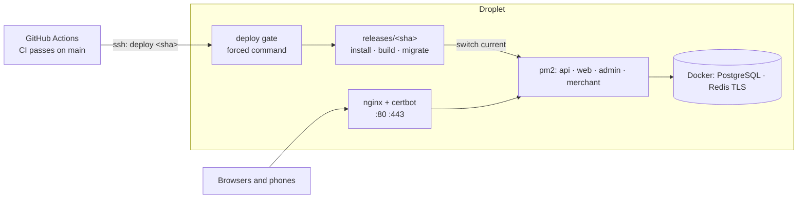

# Runbook: Deploying to DigitalOcean

This guide takes you from an empty DigitalOcean account to a live platform: the API, the web app, the
admin panel and the merchant portal on one Droplet, deployed automatically by GitHub Actions after CI
passes on `main`. The design is [ADR 075](../../adr/075-platform-deploys.md).

## The shape, in one picture



| Piece | Where it runs | File in this repo |
|---|---|---|
| API, web, admin, merchant | pm2 on the host, bound to 127.0.0.1 | `infra/pm2/ecosystem.config.cjs` |
| PostgreSQL 18, Redis 8 (TLS), Kafka (optional) | Docker, bound to 127.0.0.1 | `infra/droplet/data-services.compose.yml` |
| HTTPS | nginx + certbot (Let's Encrypt) | `infra/nginx/platform.conf.template` |
| Server preparation | once, as root | `infra/droplet/setup-droplet.sh` |
| Deploys | the deploy gate (SSH forced command) + each release's own script | `packages/tooling/src/deploy/` |
| The trigger | GitHub Actions | `.github/workflows/deploy.yml` |

The names below use the project's slug from `project.json` (here `starter-kit`) and a domain
`example.com`; replace both.

---

## Before you start: decisions to make

| Decision | Why it matters | Default in this guide |
|---|---|---|
| **Domain** | Four hostnames: `example.com` (web), `api.`, `admin.`, `merchant.` | Your domain, at any registrar |
| **Droplet size** | `next build` of three apps needs memory | **4 GB RAM / 2 vCPU** minimum (Basic, Regular), 80 GB disk. 2 GB works only with the swap file and slow builds |
| **Region** | Latency to your users | Singapore (`sgp1`) for Malaysia |
| **File storage** | A deployed API refuses local disk storage, and refuses static AWS keys (it expects an IAM role, which a Droplet doesn't have) | **Firebase Storage** (`STORAGE_PROVIDER=firebase`); the project already uses Firebase for push. AWS S3 + CloudFront is the choice when the platform runs on AWS (with an IAM role) |
| **Email** | A deployed API must send real email (`EMAIL_MODE=send`) with a verifiable webhook | Resend, with its webhook secret |
| **Managed or Docker PostgreSQL** | Backups and failover | Docker on the Droplet (your choice), with the platform's backups (step 17) and DigitalOcean's weekly Droplet backups. A Managed Database is a drop-in change of `DATABASE_URL` later |

---

## Step 1 — Accounts

1. Create a DigitalOcean account and turn on two-factor authentication.
2. Add a payment method, and set a **billing alert** (Settings → Billing → Billing alerts).
3. Create a project (e.g. "Starter Kit — production").

## Step 2 — An SSH key for you

On your laptop (skip if you have one):

```bash
ssh-keygen -t ed25519 -C "you@laptop" -f ~/.ssh/id_ed25519
```

Upload `~/.ssh/id_ed25519.pub` in DigitalOcean (Settings → Security → SSH keys).

## Step 3 — Create the Droplet

1. Create → Droplets: **Ubuntu 24.04 LTS**, the size from the table above, your region.
2. Authentication: **SSH key** (yours). Never a password.
3. Turn on **weekly backups** and **monitoring**.
4. Hostname: `<slug>-prod-1`.
5. Note its public IPv4 address.

Optional but recommended: Networking → Firewalls → create a cloud firewall allowing inbound TCP 22, 80
and 443 only, and apply it to the Droplet (the setup script also turns on `ufw`).

## Step 4 — DNS

At your DNS host, add **A records** pointing to the Droplet's IP:

| Name | Type | Value |
|---|---|---|
| `@` | A | Droplet IP |
| `www` | A | Droplet IP |
| `api` | A | Droplet IP |
| `admin` | A | Droplet IP |
| `merchant` | A | Droplet IP |

Check with `dig +short api.example.com` before step 12 (certbot needs them).

## Step 5 — Prepare the server (one script)

```bash
scp infra/droplet/setup-droplet.sh ~/.ssh/id_ed25519.pub root@<droplet-ip>:/root/
ssh root@<droplet-ip>
bash /root/setup-droplet.sh starter-kit /root/id_ed25519.pub
```

It installs security updates (and keeps them automatic), the firewall, a 4 GB swap file, Docker, nginx,
certbot, Node.js 24.22.1 (checksum-verified) with pnpm and pm2, creates the **`platform`** user (your key,
no password, in the `docker` group), lays out `/srv/starter-kit`, makes the Redis TLS certificate
authority, registers pm2 to start on boot, and finally turns SSH to keys-only with no root login.

From now on, sign in as `platform`:

```bash
ssh platform@<droplet-ip>
```

> Membership of the `docker` group is root-equivalent on that machine. Only the `platform` user and the
> deploy key (which runs one command) can sign in.

## Step 6 — The layout it created

```
/srv/starter-kit/
  repository.git/          bare mirror of the GitHub repository (step 7)
  releases/<sha>/          one directory per deployed commit (the last 5 are kept)
  current -> releases/…    the live release (pm2 runs from here)
  previous -> releases/…   the one before (rollback target)
  bin/deploy/              the deploy gate (step 14)
  shared/env/              api.env, api-migrate.env, web.env, admin.env, merchant.env (mode 600)
  shared/data/             the data-services Compose file and data.env
  shared/tls/              Redis TLS: ca.crt, redis.crt, redis.key
  shared/storage/          scratch space
```

## Step 7 — Give the Droplet read access to the repository

The Droplet fetches commits itself; it needs a **read-only deploy key**.

```bash
ssh-keygen -t ed25519 -N "" -C "starter-kit droplet (read-only)" -f ~/.ssh/github_read
cat ~/.ssh/github_read.pub
```

In GitHub: the repository → Settings → Deploy keys → Add, paste it, **leave "Allow write access" off**.

```bash
cat >> ~/.ssh/config <<'EOF'
Host github.com
  IdentityFile ~/.ssh/github_read
  IdentitiesOnly yes
EOF
ssh-keyscan github.com >> ~/.ssh/known_hosts
git clone --mirror git@github.com:<owner>/<repo>.git /srv/starter-kit/repository.git
```

## Step 8 — Start the data services

```bash
cd /srv/starter-kit/shared/data
git -C /srv/starter-kit/repository.git show main:infra/droplet/data-services.compose.yml > data-services.compose.yml
umask 077
cat > data.env <<EOF
POSTGRES_PASSWORD=$(openssl rand -hex 24)
REDIS_PASSWORD=$(openssl rand -hex 24)
EOF
docker compose -f data-services.compose.yml --env-file data.env up -d
docker compose -f data-services.compose.yml --env-file data.env ps     # both "healthy"
```

Add `--profile kafka` to both commands if you run the analytics consumer.

## Step 9 — Database logins

Two logins, never one ([separate database credentials](./separate-database-credentials.md)): the
**migration login** owns the tables, the **runtime login** is what the API uses.

```bash
source /srv/starter-kit/shared/data/data.env
RUNTIME_PASSWORD=$(openssl rand -hex 24); echo "runtime password: $RUNTIME_PASSWORD"   # keep it for step 10
docker compose -f /srv/starter-kit/shared/data/data-services.compose.yml --env-file /srv/starter-kit/shared/data/data.env \
  exec -T postgres psql -U platform_owner -d platform <<SQL
CREATE ROLE platform_migrator LOGIN PASSWORD '$(openssl rand -hex 24)' NOSUPERUSER NOBYPASSRLS;
ALTER DATABASE platform OWNER TO platform_migrator;
ALTER SCHEMA public OWNER TO platform_migrator;
CREATE ROLE platform_runtime LOGIN PASSWORD '${RUNTIME_PASSWORD}' NOSUPERUSER NOBYPASSRLS;
SQL
```

Set the migrator's password the same way (print it before running) and keep both passwords for step 10.
`platform_owner` (the container's superuser) is for emergencies only; nothing runs as it.

After the first deploy (step 16) has run `db:deploy`, which creates `app_runtime`, finish the runtime login:

```sql
GRANT app_runtime TO platform_runtime;
```

## Step 10 — The env files

Each app reads `shared/env/<app>.env` (linked into every release as `apps/<app>/.env`). Start from each
app's `.env.example` in the repository, then set at least the values below.

```bash
cd /srv/starter-kit/shared/env
for app in api web admin merchant; do
  git -C /srv/starter-kit/repository.git show main:apps/$app/.env.example > $app.env
done
chmod 600 *.env
```

**`api.env`** — the runtime login, real hosts and the production rules the API enforces at boot:

| Variable | Value |
|---|---|
| `NODE_ENV` | `production` |
| `APP_NAME` | your product's name |
| `HOST` / `PORT` | `127.0.0.1` / `8080` |
| `TRUST_PROXY` | `127.0.0.1` (nginx) |
| `APP_URL`, `ADMIN_APP_URL`, `MERCHANT_APP_URL` | `https://example.com`, `https://admin.example.com`, `https://merchant.example.com` |
| `CORS_ORIGINS` | the three URLs above, comma-separated |
| `COOKIE_DOMAIN` | `example.com` |
| `DATABASE_URL` | `postgresql://platform_runtime:<runtime password>@127.0.0.1:5432/platform` |
| `REDIS_URL` | `rediss://:<REDIS_PASSWORD>@127.0.0.1:6380` (TLS; pm2 gives the API the CA from `shared/tls/ca.crt`) |
| `CACHE_ENCRYPTION_KEYS`, `MFA_ENCRYPTION_KEYS`, `NOTIFICATIONS_ENCRYPTION_KEYS`, … secrets | generate fresh ones: `pnpm tools secrets:generate` on your laptop (never reuse development values) |
| `TENANT_KMS_PROVIDER` / `TENANT_ENCRYPTION_MASTER_KEY` | `local` / a fresh key |
| `EMAIL_MODE`, `RESEND_API_KEY`, `RESEND_WEBHOOK_SECRET`, `EMAIL_FROM_ADDRESS` | `send` and your Resend values |
| `STORAGE_PROVIDER` and the Firebase settings | `firebase` (see the decision table) |
| `LOGIN_VERIFICATION_MODE` | `new-device` (`disabled` is refused in production) |
| `PASSWORD_BREACH_CHECK` | `hibp` |
| `SWAGGER_ENABLED` | `0` unless you need the docs in production (they're SuperAdmin-only either way) |

**`api-migrate.env`** — a copy of `api.env` with **only** `DATABASE_URL` changed to the migration login:

```bash
sed 's#^DATABASE_URL=.*#DATABASE_URL=postgresql://platform_migrator:<migrator password>@127.0.0.1:5432/platform#' api.env > api-migrate.env
chmod 600 api-migrate.env
```

**`web.env`, `admin.env`, `merchant.env`** — `NEXT_PUBLIC_API_URL=https://api.example.com`, each app's
own public URL, `COOKIE_DOMAIN=example.com`, `NODE_ENV=production`. `NEXT_PUBLIC_*` values are baked in
at build time, so a change needs a redeploy.

The API validates every variable at boot and names the ones that are wrong; the deploy's health check
fails (and rolls back) if it doesn't start.

## Step 11 — pm2

Installed and registered for boot by step 5. Useful commands as `platform`:

```bash
pm2 ls                         # starter-kit-api, -web, -admin, -merchant
pm2 logs starter-kit-api       # follow one app's log
pm2 monit                      # CPU and memory per process
```

Log rotation: `pm2 install pm2-logrotate && pm2 set pm2-logrotate:max_size 50M && pm2 set pm2-logrotate:retain 14`.

## Step 12 — nginx and HTTPS

Root login is disabled, so do this step from the DigitalOcean **Droplet console** (Access → Launch
Droplet Console), which signs you in as root:

```bash
git -C /srv/starter-kit/repository.git show main:infra/nginx/platform.conf.template \
  | sed -e "s/__DOMAIN__/example.com/g" > /etc/nginx/sites-available/platform.conf
ln -sf /etc/nginx/sites-available/platform.conf /etc/nginx/sites-enabled/platform.conf
rm -f /etc/nginx/sites-enabled/default
nginx -t && systemctl reload nginx
certbot --nginx --redirect --agree-tos -m you@example.com \
  -d example.com -d www.example.com -d api.example.com -d admin.example.com -d merchant.example.com
```

certbot adds the HTTPS listeners and renews automatically (`systemctl list-timers | grep certbot`).
Add HSTS once HTTPS works: `add_header Strict-Transport-Security "max-age=31536000; includeSubDomains" always;`
in each `listen 443` block, then `nginx -t && systemctl reload nginx`.

## Step 13 — The deploy key for GitHub Actions

GitHub Actions gets its **own** key, which can run exactly one program — the deploy gate — and nothing
else (no shell, no forwarding).

On your laptop:

```bash
ssh-keygen -t ed25519 -N "" -C "github-actions deploy" -f ./deploy_key
```

On the Droplet, as `platform`, append one line to `~/.ssh/authorized_keys` (one line, no breaks):

```
command="DEPLOY_ROOT=/srv/starter-kit /usr/local/bin/node /srv/starter-kit/bin/deploy/packages/tooling/src/deploy/gate-cli.ts",no-pty,no-port-forwarding,no-agent-forwarding,no-X11-forwarding ssh-ed25519 AAAA…(deploy_key.pub)… github-actions deploy
```

## Step 14 — Install the deploy gate

```bash
mkdir -p /tmp/gate && git -C /srv/starter-kit/repository.git archive main packages/tooling/src/deploy tooling.config.ts | tar -x -C /tmp/gate
rm -rf /srv/starter-kit/bin/deploy && mv /tmp/gate /srv/starter-kit/bin/deploy
```

The gate is small and rarely changes; everything else a deploy does comes from the release being deployed.
The gate reads `tooling.config.ts`, so it keeps the repository's folder layout. Repeat this step when `src/deploy/gate-cli.ts`, `src/deploy/deploy-plan.ts` or `tooling.config.ts` change (the release notes say so).

## Step 15 — GitHub settings

1. Settings → Environments → **New environment** `production`. Optionally add yourself as a required
   reviewer (every deploy then waits for your approval) and restrict it to the `main` branch.
2. In that environment, add the **secrets**:

| Secret | Value |
|---|---|
| `DEPLOY_HOST` | the Droplet's IP (or a DNS name for it) |
| `DEPLOY_USER` | `platform` |
| `DEPLOY_SSH_KEY` | the contents of `./deploy_key` (the private key), then delete the file |
| `DEPLOY_KNOWN_HOSTS` | the output of `ssh-keyscan -t ed25519 <droplet-ip>`: the pinned host key |

3. Settings → Secrets and variables → Actions → **Variables** → `DEPLOY_ENABLED` = `true`.

Until `DEPLOY_ENABLED` is `true` the Deploy workflow skips itself, so forks never fail on it.

## Step 16 — The first deploy

Actions → **Deploy** → Run workflow → action `deploy`, commit empty (latest `main`). Watch the log: the
Droplet fetches the commit, unpacks it into `releases/<sha>`, installs, builds, migrates with the
migration login, loads the reference data, switches `current`, starts the four processes and checks each
one's health.

Then, once:

1. `GRANT app_runtime TO platform_runtime;` (step 9), then redeploy (or `pm2 reload all`).
2. **Create the first SuperAdmin** — never seed production:
   ```bash
   cd /srv/starter-kit/current
   DOTENV_PATH=/srv/starter-kit/shared/env/api-migrate.env \
     pnpm --filter @workspace/api admin:bootstrap-superadmin -- --email you@example.com --full-name "Your Name"
   ```
   It asks for the password ([SuperAdmin bootstrap](./superadmin-bootstrap.md)).
3. `pm2 save` (the deploy does it too).
4. Sign in at `https://admin.example.com` and set up two-factor authentication.

From now on every push to `main` that passes CI deploys itself.

## Step 17 — Backups

| What | How | Restore test |
|---|---|---|
| PostgreSQL | The platform's own backups (Operations → Backups; `BACKUP_ENABLED=true`, `BACKUP_DIR=/srv/starter-kit/shared/backups`), copied off the Droplet (e.g. to Firebase Storage or another provider) | Restore the latest into a scratch database monthly (see *Follow-ups*) |
| Redis | Append-only file in its Docker volume; queues refill from the outbox | — |
| The whole Droplet | DigitalOcean weekly backups (step 3) | Restore to a new Droplet once a quarter |
| Env files | `shared/env/*.env`: keep an encrypted copy in your password manager | — |

## Step 18 — Monitoring

1. Install the **server agent** so the Operations console shows CPU, memory, disk and up/down
   ([Platform operations console](./platform-operations-console.md)): register the server in the admin
   panel, then run it with its token under pm2 from `current/apps/server-agent`.
2. DigitalOcean → Monitoring → alert policies: CPU > 80 % for 10 min, memory > 90 %, disk > 80 %.
3. An uptime check on `https://api.example.com/health/ready`.

---

## Day 2

### Deploying

Merge to `main`. CI runs; when it passes, **Deploy** runs. If a required reviewer is set, approve it in
the Actions tab.

To deploy a particular commit of `main` (for example to redeploy after changing an env file):
Actions → Deploy → Run workflow → `deploy`, commit = the full SHA.

### Rolling back

Actions → Deploy → Run workflow → action **`rollback`**. The previous release is re-activated without a
build or a migration (it was built when it was deployed). Rolling back does **not** undo migrations,
which is why migrations must be backward compatible (below).

A failed health check rolls back on its own and fails the workflow.

### Writing migrations that deploy safely

Migrations run **before** the new code goes live, while the old release is still serving. Every migration
must therefore work with the code that is already running (expand/contract):

| Change | Release 1 | Release 2 |
|---|---|---|
| Add a column | Add it nullable or with a default; write it | Make it required if needed |
| Rename a column | Add the new one, write both, backfill | Read the new one; drop the old one in a later release |
| Drop a column | Stop using it | Drop it |
| Add a table | Add it | — |

### Changing an env file

Edit `shared/env/<app>.env`, then redeploy the live commit (a `NEXT_PUBLIC_*` change needs the rebuild),
or for an API-only change `pm2 reload starter-kit-api --update-env`.

### If a deploy is stuck

`deploy.lock` exists while a deploy runs. If a deploy was killed, check nothing is running
(`ps aux | grep deploy-`) and remove `/srv/starter-kit/deploy.lock`.

### Manual recovery (the automatic rollback failed too)

```bash
ls -lt /srv/starter-kit/releases                 # pick a release that worked
ln -sfn /srv/starter-kit/releases/<sha> /srv/starter-kit/current
pm2 startOrReload /srv/starter-kit/current/deploy/pm2/ecosystem.config.cjs --update-env
pm2 logs --lines 200                             # read why it failed
```

### Updating the server

Security updates are automatic. Monthly: `sudo apt-get upgrade`, reboot in a quiet hour, check
`pm2 ls` and the health URL. Node.js upgrades follow `.nvmrc`: re-run `setup-droplet.sh` with
`NODE_VERSION=<new>` from the Droplet console.

## Troubleshooting

| Symptom | Likely cause | Fix |
|---|---|---|
| Workflow fails at "Deploy over SSH" with `Host key verification failed` | `DEPLOY_KNOWN_HOSTS` is wrong, or the Droplet was rebuilt | Re-run `ssh-keyscan` and update the secret, after confirming the change is yours |
| `Refused: expected deploy <full commit sha>` | Something other than the workflow used the key | Only the workflow should hold it; rotate the key if in doubt |
| `… is not a commit on main` | A commit from a branch or a fork | Merge it first |
| `Missing /srv/…/shared/env/api-migrate.env` | Step 10 incomplete | Create the file |
| Build killed (`Killed`, exit 137) | Out of memory | Bigger Droplet, or check the swap file is on (`swapon --show`) |
| API unhealthy after the switch | A bad env value | `pm2 logs starter-kit-api`: the API names the variable |
| `must use rediss://` at boot | `REDIS_URL` without TLS | Use `rediss://…:6380` (step 10) |
| Browsers block requests to the API | `CORS_ORIGINS` or `NEXT_PUBLIC_API_URL` wrong | Fix the env files and redeploy |

## Follow-ups

- **Build in CI, ship the artifact**: today the Droplet builds each release. ADR 075 describes moving the
  build to GitHub Actions once Next.js standalone output is in place.
- **An automated restore drill** (enhancement 2.6).
