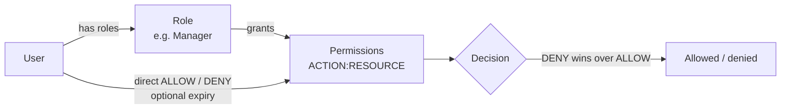

# 9. Platform administration

Everything here happens in the **admin panel**. Each screen needs a permission (an `ACTION` on a
`RESOURCE`, for example `READ` on `GEO`); SuperAdmins have all of them.

## Users

**Users → All users**: search, open a user, see roles and status, unlock a locked account.
**Users → MFA recovery**: approve or deny recovery requests
([Account and security](./10-account-and-security.md#lost-your-authenticator-mfa-recovery)).
**Ban / unban** (SuperAdmin, on a user's page): a ban needs a reason, signs the account out on
every device and stops it signing in; unban restores it. You cannot ban yourself or another
SuperAdmin. Both are audited, and **Banned** is a status filter on the user list.
**Users → Support access**: time-boxed access to a merchant's data
([Account and security](./10-account-and-security.md#support-access-time-boxed-access-to-a-merchant)).

## Merchants: suspension, bans and appeals

Open a merchant (**Merchants → All merchants → its name**) to see its lifecycle. **Suspend** (with a
reason) pauses its portal and rewards; its members see a suspension screen, the owner can send one
appeal at a time, and other members can leave the merchant. **Reinstate** (with a reason) ends the
suspension; **Reject** answers a pending appeal with a note the owner sees. A merchant whose owner
asked for deletion can be reactivated by that owner until the grace period ends.

**Ban merchant** (SuperAdmin only, with a reason) is harder than a suspension: the merchant cannot
appeal, a pending appeal is closed, its rewards leave the marketplace and cannot be claimed, and
its tills stop working. Its members see a "banned" screen; everyone but the owner can leave.
**Lift ban** (with a reason) makes the merchant active again. **Banned** is a status filter on the
merchant list. The seeded **Lucky Gold Traders** is banned, for trying it out.

## Roles and permissions (Settings → Access control)

- **Roles** bundle permissions (each role lists its own; none inherits another's). Create, rename, deactivate,
  soft-delete and restore roles; **preview** what a user would be able to do before assigning.
- **Permissions** are `ACTION:RESOURCE` pairs (actions: `CREATE`, `READ`, `UPDATE`, `DELETE`,
  `LIST`, and lifecycle verbs such as `APPROVE`, `SUSPEND`, `BAN`). They can also be granted or denied to one user directly, optionally until a
  date. A direct **DENY** always wins.
- **Check** shows whether a user has a permission; the API's **explain** answers "why was this
  403?".
- Every change bumps the affected users' token version, so new permissions apply on their next
  request.

Merchant staff roles (Owner, Admin, Cashier, …) are a separate, per-tenant system managed
by the merchant ([Stores and team](./03-stores-and-team.md)): each merchant edits its own roles,
gives a teammate an extra permission for a while or for good, and shares one record with one teammate.
Admin → Access control shows the tenant role templates every new merchant starts from.

## Audit log

Every request to the API — reads included, whether it succeeded or was refused — is recorded
once, append-only and kept forever ([ADR 025](../adr/025-global-http-audit-log.md)). Only the
automated health checks are left out. Open **Platform → Audit log** to see it.
Admins, Managers and SuperAdmins can open it (`LIST:AUDIT_LOG` for the table, `READ:AUDIT_LOG` for
a record).

- **The table** shows, newest first: time and duration, method and endpoint, outcome and HTTP
  status (with the error code of a refused request), the user (and the SuperAdmin behind an
  impersonation), tenant, device (desktop / mobile / tablet / bot, browser and OS), IP
  address with its class (public, private network, carrier NAT …), country and city, and the
  credential — colour-coded. Filter by outcome, method, credential, device or address class, or
  search a path, endpoint, error code, IP address, User-Agent or correlation id. Filters live in
  the address bar, so you can share a filtered view.
- **Click a row** to open its full record in a side drawer; **Open full page** gives the record
  its own link.
- **Location** (country, region, city, time zone) comes from the CDN in front of the API. When
  the API is not behind one (local development, a direct connection), it is empty.
- **A record** adds everything else: the impersonation session, API key and POS terminal, store
  and location, user agent, client app, Origin, Referer, Accept-Language, host, HTTP version,
  request size, idempotency key, correlation and trace ids, the row-level-security bypasses the
  request used, and the route params, request body and response body. Click an actor,
  tenant or correlation id to see every other record for it.
- Secrets read `[REDACTED]` and personal data is masked: they are removed **before** a record is
  stored, so nobody — including you — can see them.
- Looking at the audit log is itself recorded, so you can always answer "who looked at this?" —
  the record shows what was viewed, not the data itself.

## Emails

- **Emails → Templates**: preview every transactional email with sample data and **send a test**
  (it goes to the template's sample recipient — in local development that is the Mailpit inbox; with
  Resend, `EMAIL_TEST_TO` sends it to your own inbox instead).
- **Emails → Log**: every outbound email with its delivery status (`sent`, `delivered`,
  `bounced`, `complained`, `failed`), updated live from Resend's webhooks
  ([Email setup](../technical/email/resend-setup.md)).

## Geography

Regions, subregions, countries, states and cities used by address forms: list, search, create,
edit, soft-delete (with a preview of what a delete cascades to), import (validate first) and
export.

## Catalog (Products, Categories)

Sample modules that show the full pattern every new feature follows: lists with sort, filter and
search, detail pages, create and edit forms, soft delete, restore and bulk actions.

## Kanban boards (Components → Kanban)

Two linked boards for the platform team, switched with **Planning** / **Execution** at the top left:

- **Planning** holds **epics** and **features** as they move through planning: Backlog → Refining →
  Ready → Planned → Delivered. Their cards show how many of their children are done and how many of
  their stories' **story points** are done.
- **Execution** holds the work: **stories**, their **tasks** and the tasks' **subtasks** (To Do → In
  Progress → Review → Done). Stories carry the estimate (1, 2, 3, 5, 8, 13 or 21 points); tasks and
  subtasks follow their story's dates.

Every card starts with what it is — its level and its key, like **STORY STORY-142** — so you can tell
an epic from a subtask at a glance, and name it in a chat. Each item sits under the level above it: a
feature under an epic, a story under a feature, a task under its story, a subtask under its task. A
subtask breaks down further into **steps** (sub-subtasks and sub-sub-subtasks), a checklist on it.

- **Change a card's status**: drag it to another column, or use its **⋯ → Move to column**. Someone
  else moved it first? The board reloads and tells you. Dragging works in **Board order** only.
  Marking an item **Done** (or a planning item **Delivered**) while work under it is still open asks
  you to confirm first.
- **Move an item under another parent**: **⋯ → Move to…** on its card or its page (or ⌘K). Pick the
  feature, story or task it belongs under — search by key or title. It keeps its place on the board;
  the toast's **Undo** puts it back.
- **Group by**: the execution board is split into one lane per **feature** until you pick **Epic**,
  **Story** or **None**; the planning board can group by **Epic**. Your choice is remembered; **Reset
  to default** forgets it.
- **Show subtasks**: subtask cards are hidden until you turn them on in **Group by**, or press a task's
  **3 subtasks · 1 done**.
- **Active features**: the strip above the execution board lists each feature with work open — its
  epic, its stories done, and its dates. Pick one to show only that feature's work; pick it again to
  show everything.
- **WIP limits**: an execution column's header shows its stories and tasks against its limit — `5/6 ·
+3 subtasks` — amber at the limit and red over it (subtasks never count). Admins set it from the
  column's **⋮ → Set WIP limit**.
- **Find cards**: search (keys, titles, descriptions, labels, people, and a parent's title), **Filter**
  by type, priority or team, **Sort**; switch to **Hierarchy**, **List** or **Table**. ⌘K finds any
  item by its key or title, too. All of it is kept in the address, so you can share the view.
- **Hierarchy**: both boards as one tree — epics, features, stories, tasks, subtasks and their steps.
- **Add items**: **Add story/feature**, the **+** on a column, **Add from template**, or **Import CSV**.
  From an item's page, **Add …** creates a child already under it.

**An item's page** reads like a document. At the top is where it sits (Board / epic / feature / story /
task, each with its key) with **Watch**, **Move to…**, **Edit** and delete. Then come its level and key,
the title, and its properties: status, type, parent, assignee, reporter, priority, team, dates,
points, progress and how many children, steps or criteria are done, labels, watchers, and when it was
created and last edited. Below them are the description, its checklist (tick rows off in place), its
children, **linked items** (blocks, blocked by, relates to; a blocked card shows a red blocked mark),
files and comments. **History** at the bottom opens to show who changed what, and when. Comments can
carry **files**: the paperclip in the comment box attaches up to 5 PDFs or images. On an item's page,
⌘K lists its actions first: Move to…, Change status, Edit.
**Edit** opens the item's own page for its details, labels, checklist, assignee, dates and estimate.

Permissions: `LIST`/`READ` `KANBAN_TASK` to see the boards and items (and to watch), `CREATE` to add
items, `UPDATE` to edit, move, link, tick checklists, comment and attach, `DELETE` to delete items (once
they have no children), and `UPDATE` on `KANBAN_BOARD` to rearrange columns and set WIP limits. Admins
have all of them. Anyone holding `READ` can be assigned.
The boards sit in the Components section, so they are shown where that section is enabled
(`ADMIN_COMPONENT_GALLERY`).

## Under the hood

[Roles, permissions, policies and audit API](../technical/api-reference/access-control.md) ·
[Email API](../technical/api-reference/email.md) · [Geography API](../technical/api-reference/geography.md) ·
[Sample catalog API](../technical/api-reference/catalog-samples.md) ·
[Authorization overview](../technical/authorization/overview.md).
