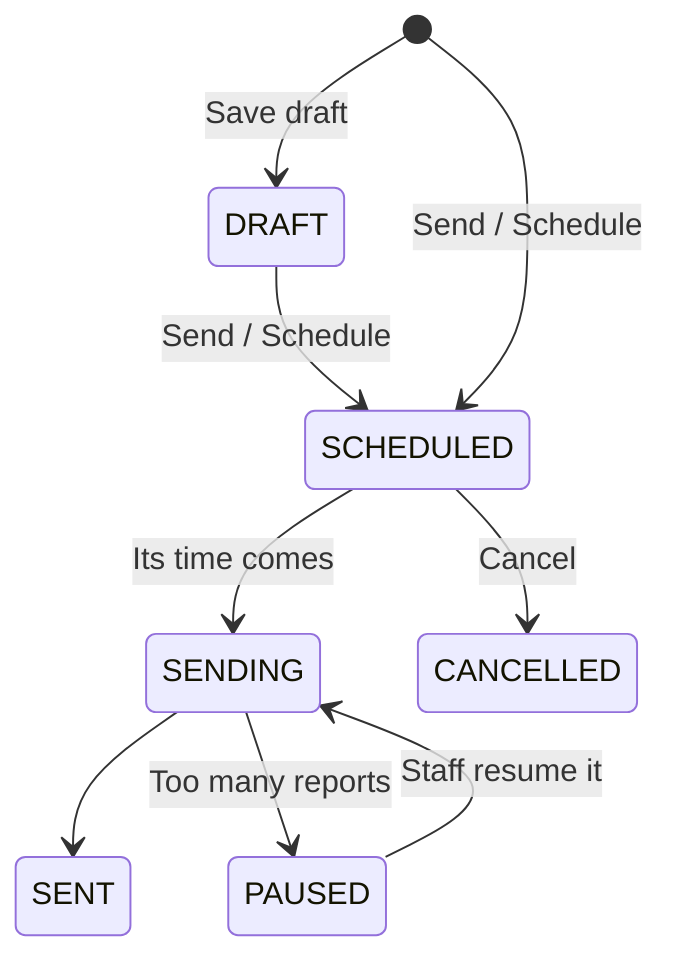

# 12. Notifications and broadcasts

Everything the platform tells a person — a new sign-in, a reward approved, a shop's weekend offer, a
server alert — arrives the same way: under the **bell** in the app they use, and, depending on their
settings, by **email** and as a **notification on their phone**. How it works under the hood:
[Notifications: how they work](../technical/notifications/overview.md).

## For everyone

### The bell

| App | What the bell shows |
| --- | --- |
| Web, merchant portal, admin panel | The number of unread notifications ("3", "99+"). Click it for the newest four; **View all notifications** opens the full page |
| Phone app | The same number on the header's bell. Tap it for the notifications screen |

The number updates **by itself** the moment something new arrives — no refresh needed. Each app shows
only its own notifications: a merchant's reward-review notices never appear in the customer app.

### The notifications screen (phone app)

```
[ All ] [ Unread ]                         ✓✓   ⚙
New
 (K&)  Weekend specials Half price lattes all Saturday…   •  ⋯
       25m
 (🛡)  New sign-in Chrome on macOS · Kuala Lumpur         •  ⋯
       2h
Earlier
 (🔑)  Password changed Your password was changed…           ⋯
       3d
            [ See earlier notifications ]
```

- **All / Unread** filter the list; **✓✓** marks everything read; **⚙** opens the settings.
- **New** is the last day, **Earlier** the rest. Unread rows are tinted, with a dot.
- Each row starts with the sender's logo or initials (a shop), or the kind of notice's symbol (the app
  itself).
- **Tap** a notice to read it in full — a shop's message with its formatting, table, code or button —
  and it is marked read.
- **⋯** on a row: **Mark as read**, **Remove this notification**, **Report as spam / offensive / a
  scam** (shops' messages only), **Notification settings**.

### The notifications page (web, merchant portal, admin panel)

**View all notifications** under the bell. Each notice shows:

| Part | What it tells you |
| --- | --- |
| Picture | The sender's initials (a shop), or the kind's symbol (the platform itself) |
| Kind and sender | "Security", "Activity", "Operations"… and who sent it |
| Time | "5 minutes ago"; hover for the exact date and time |
| Title and message | The whole message, line by line — an operations alert says what, where, the limit and the reading |
| Dot | Unread |
| **Open** | Goes where the notice points (an alert, a reward, a broadcast) and marks it read |

Filter by **All / Unread / Archived** and by **kind** ("Only Operations"). Each notice also has
**Read the full message** (a shop's broadcast), mark read, archive and **Report**.

### Phone notifications

1. In the phone app: **Settings → Notification settings → Turn on notifications**. The app explains
   what you'll get first, then your phone asks for permission.
2. From then on, notices arrive as phone notifications too. Each one says who and what in the title
   ("High CPU on web-01", "Brew & Bean") and the details underneath — pull it down to read every line.
   Tapping one opens the app's notifications and marks it read everywhere.
3. On Android, each kind of message has its own entry under the phone's **Settings → Apps → the app →
   Notifications** (Security, Account, Activity, Product news, Offers, Operations), so you can, say,
   silence Offers but keep Security loud.
4. You never need to do it again: the app keeps your phone registered on its own, even after signing
   out and back in.

Only security notices and operations alerts buzz your phone during your **quiet hours**; everything
else waits until they end.

### Notification settings

**Settings → Notification settings** (web `Notifications → Settings`, merchant and admin the same):

| Section | What you choose |
| --- | --- |
| What reaches you | A tree: each **kind of message** (Security, Account, Activity, Product news, Offers; Operations for platform staff) with a checkbox and a line about it, and its channels (In app, Email, Phone, SMS) hanging under it on a line, each with its own checkbox. Tick a kind to get all of it, or tick each channel on its own |
| Quiet hours and digest | Quiet hours (from–until, in your time zone) and an email digest (each one, once a day, once a week) |
| Offers | **News and offers from us**, and **Offers from this store** for each shop you claimed from. **Leave store** stops that shop for good, until you claim from it again |
| Phones (web, merchant, admin) | The phones that get your notifications; **Remove** one you no longer use |

Every change saves at once. Security notices always reach you in the app and by email.

**Reading a checkbox**

| Looks like | Means |
| --- | --- |
| Filled colour, with a tick | **On** — for a kind, every channel you can get it on is on |
| Filled colour, with a dash | **Some** — a kind with some of its channels on; tap it to turn on the rest |
| Empty box | **Off** — tap it to turn it on |
| Faded | **Not available yet** — the line underneath says what to do first ("Add and verify your phone number first") |
| Pale colour, with a lock | **Always on** — the line underneath says why ("Always on, to keep your account safe") |

Ticking or unticking a kind changes only the channels you can change; the always-on ones stay on.
A channel a kind of message is never sent on (security notices by SMS) is not shown at all.

### Unsubscribe and report

- Every email except security notices has an **Unsubscribe** link. It opens a page that asks before
  doing anything, then says exactly what stopped ("You won't get offers from Brew & Bean by email any
  more").
- **Report** a shop's message if it is spam, offensive or a scam. Platform staff review it; too many
  reports pause the shop's messages.

## For merchants: messaging your customers

**Customers → Broadcasts** (owners and managers; not cashiers).



1. **New broadcast** → a **title** and the **message**: bold, italic, headings, lists, a quote, a
   table, a code (for a promo code), a link (`https://` only) and one **button**.
2. **Who gets it:**
   - **All my customers**, optionally only those who claimed within the last N days (60 by default) or
     who redeemed; or
   - **Customers I pick**: search by name or email and tick one person or a group.

   The **live count** says how many will get it, and how many are left out and why (opted out,
   banned, left, your own staff) — never their names.
3. **How:** in the app, by email and on their phones (never SMS).
4. **When:** now, at a set time, or at a set time **in each customer's own time zone** (9 a.m.
   wherever they are).
5. **Preview** shows exactly what customers will see; then **Send** (or **Schedule**). Without the
   *Approve broadcasts* permission you can save drafts for someone who has it.

| Rule | |
| --- | --- |
| Weekly allowance | 5 broadcasts a week ("2 of 5 this week"); cancelled ones don't count. Platform staff can raise it for your business |
| Who can receive | Only your own customers (people who claimed one of your rewards) who agreed to your offers |
| Links | `https://` only, no link shorteners; a refused link is named before sending |
| Reports | At 10 reports (or 1% of the audience) the broadcast and your other scheduled ones pause for review. Three upheld reports in 90 days switch your broadcasts off until staff turn them back on |

The broadcast's page shows its status and, per channel, how many were delivered, held back (with the
reason), failed and opened. It refreshes by itself while it is sending.

Rewards can be private too: **Who can claim → Chosen customers** on the reward editor
([Rewards](./04-rewards.md)).

## For platform staff

### Sending a broadcast yourself (SuperAdmin, Admin)

**Emails → Broadcasts → New broadcast** in the admin panel. The same composer as merchants', with the
platform's own audience:

1. A **title** and the **message**.
2. **Who gets it:** **Customers** (the web and phone app), **Merchant staff** and/or **Platform
   staff**; for merchant staff, optionally only those of **active** or **restricted** stores; and
   optionally only people who **signed up on or after** a date. The live count says how many will get
   it and how many are left out (opted out, banned, closed their account).
3. **Kind of notice:** **Product news** (new features, planned maintenance — people can turn these
   off) or **Account notice** (something about their account or the terms they agreed to).
4. **How** and **When**, as for merchants. **Preview**, then **Send** or **Schedule**.

A notice to **everyone** — all three apps, no date, no store filter — waits for a **second staff
member** to approve it on its page. Without the *Publish broadcasts* permission you can save drafts
only. The broadcast's page has **Edit** (drafts), **Send**, **Approve** and **Cancel broadcast**.
Platform Developers don't send broadcasts.

| Where | What |
| --- | --- |
| **Emails → Broadcasts** | Every broadcast with its message; **New broadcast**; **Approve** (a platform message to all users needs a second person), **Cancel**; open **reports** with **Dismiss**, **Resume** and **Uphold** (a strike) |
| **Operations → Rate limits** | Raise a business's weekly broadcast allowance with an override (an end date and a reason) |
| Bell, phone and email | **Operations alerts** — a server, instance, dependency or address in trouble, and when it recovers. Every SuperAdmin, Admin and Platform Developer gets them, at any hour; the Operations switch in their settings can turn only the email off ([Operations console](./11-operations-console.md#alerts)) |

## Try it

| What | How |
| --- | --- |
| A few notifications for yourself | `pnpm --filter @workspace/api notifications:demo` (the SuperAdmin by default) |
| A platform broadcast | Admin panel as the SuperAdmin → **Emails → Broadcasts → New broadcast** → tick **Customers** → **Send**; it reaches every customer's bell |
| A broadcast | Merchant `brew.owner@kl-rewards.demo` → **Customers → Broadcasts → New broadcast** → pick Alice → **Send**; then the web app as `alice.johnson@example.com` |
| Emails | Mailpit at http://localhost:8025 |
| Phone notifications | [Push notifications setup](../technical/notifications/push-setup.md) |
